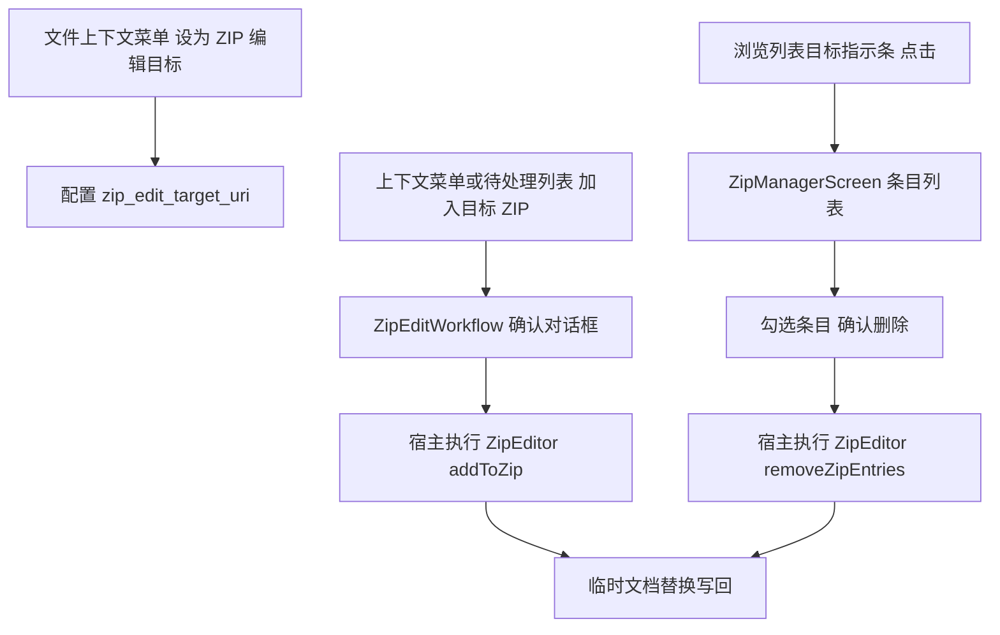

# ZIP 编辑功能设计文档

## 1. 设计目的

用户经常维护一类"内容包"性质的 zip（如压缩 Markdown 文章、图片包、词典配套资源）。当前的 zip 能力是单向的：只能整体压缩或整体解压。往包里补一个文件，或从包里清掉一个不要的文件，都必须"解压—修改—重新压缩"整个流程，文件越多越不可接受。

本设计在文件浏览域增加一对互逆的编辑能力：

1. **加入**：用户先指定一个 zip 作为"ZIP 编辑目标"，之后任意文件（单选或经待处理列表批量）可一步加入该目标；
2. **条目删除**：打开目标 zip 的内容列表，勾选不需要的条目删除。

设计基线：main 分支 459a654 之后（2026-09-22），文档随实现迭代更新。

### 边界（v1 不做）

- 目标限定**未混淆、无密码**的 `.zip` 文件。`.zip.qx`（快速混淆）文件需先解除混淆再设为目标——混淆与密码各自已有成熟交互，自动串联（解混淆-编辑-重混淆）会为加入和管理两条链路各引入一次密码 UI，收益不成比例。zip4j 层面支持密码 zip，后续扩展只需补交互。
- 7z / rar / tar 不在编辑范围内。
- 编辑为全量重写（见 2.2），不追求增量性能。

## 2. 设计逻辑

### 2.1 概念空间

- **ZIP 编辑目标（target）**：持久配置中记录的一个 zip 文档 URI。它是所有"加入"操作的唯一落点；浏览列表顶部为它显示一条常驻指示条。同一时刻至多一个（功能身份单数，不预铺"通用操作目标"概念）。
- **加入（add）**：把若干源文档追加进目标 zip 成为新条目；与目标 zip 内已有条目同名时自动改名（`a.txt` → `a (1).txt`）。
- **条目管理（manage）**：只读列出目标 zip 的全部条目，支持勾选删除。

### 2.2 写回安全：中转重写与临时文档替换

zip 格式无法原地追加或删除条目（central directory 在文件尾部），任何编辑都是**读全量—重建—写回**。唯一的设计自由度是"写回"如何避免中断损坏原文件。本设计采用两级保护：

1. 编辑全程在应用 cacheDir 中转：先复制目标 zip 到本地，zip4j 在本地文件上完成加入/删除（zip4j 只支持 `java.io.File`，这与现有 compressToZip/unzipToParent 的中转惯例一致）；
2. 写回优先走**临时文档替换**：在目标同级目录创建临时文档 → 完整写入 → 删除原文档 → 将临时文档重命名回原名。任何时刻中断，原文件要么完好，要么数据完整地留在临时文档中，不存在"半新半旧"状态。唯一的损坏窗口是"删原—改名"两次调用之间，窗口极小。若 provider 不支持按目录解析创建临时文档，则退化为直接覆写原 URI（此时中断会损坏原文件，记录日志提示）。

### 2.3 操作流与状态

加入与删除都是长时操作（复制 + 重写 + 写回），复用 ArchiveOperation 已验证的"workflow 管表单、宿主管编排"模式：



进度上报沿用 `(done, total)` 惯例，阶段（复制目标 / 修改 / 写回）作为枚举由 UI 层映射文案。目标配置与最近列表同样遵循"发现即清"：使用前校验目标存在，失效则清空配置并提示。

### 2.4 功能落点与既有模块的关系

| 落点 | 职责 |
|---|---|
| `file/ZipEditor.kt`（新增） | 核心编辑原语：列条目 / 加入 / 删除条目；本地 File 纯函数与 SAF 编排分两层，纯函数可单测 |
| `data/Preferences.kt` | 新键 `zip_edit_target_uri` |
| `ui/ConfigService.kt` | 新增 `ZipEditConfigView` 投影（目标读写） |
| `ui/ZipEditWorkflow.kt` + `ZipEditDialogs.kt`（新增） | 加入确认、进度、结果对话框的状态机 |
| `ui/ZipManagerScreen.kt`（新增） | 目标条目列表 + 勾选删除（浏览器域临时 Route） |
| `ui/BrowserScreen.kt` | 上下文菜单两项 + 顶部目标指示条 |
| `ui/PendingListScreen.kt` | 批量动作"加入目标 ZIP" |
| `ui/PlataleaApp.kt` | 编排：设目标、执行加入/删除、挂 ZipManager Route |

## 3. 核心数据结构

```kotlin
/** zip 条目的只读描述，列表展示用 */
data class ZipEntryInfo(
    val name: String,          // zip 内路径
    val size: Long,            // 原始大小
    val compressedSize: Long,
    val lastModifiedTime: Long,
    val isDirectory: Boolean
)

/** 一次编辑的结果：同名改名明细需要反馈给用户 */
data class ZipEditResult(
    val ok: Boolean,
    val renamed: List<Pair<String, String>> = emptyList(), // (原名, 最终条目名)
    val error: String? = null
)

/** 进度阶段 */
enum class ZipEditStage { COPY_TARGET, MODIFY, WRITE_BACK }
```

配置仅一个字符串键：`zip_edit_target_uri`（目标 URI），显示名使用时实时解析。

## 4. 接口定义

### 4.1 编辑原语（file/ZipEditor.kt）

```kotlin
/** 列出目标 zip 全部条目；目标不可读/非 zip 返回 null */
fun listZipEntries(context: Context, zipUri: Uri, treeUri: Uri?): List<ZipEntryInfo>?

/** 把 sources 追加进目标 zip（目录源按目录条目加入），同名自动改名 */
fun addToZip(
    context: Context, targetUri: Uri, treeUri: Uri?, sourceUris: List<Uri>,
    setProgress: (ZipEditStage, Int, Int) -> Unit, shouldCancel: () -> Boolean
): ZipEditResult

/** 从目标 zip 删除指定条目 */
fun removeZipEntries(
    context: Context, targetUri: Uri, treeUri: Uri?, entryNames: List<String>,
    setProgress: (ZipEditStage, Int, Int) -> Unit, shouldCancel: () -> Boolean
): ZipEditResult
```

内部约定：`addFilesToZipFile` / `removeEntriesFromZipFile` / `listEntriesOfFile` 三个本地 File 纯函数承载全部 zip 语义（单测覆盖），SAF 层只做中转与写回。

### 4.2 配置投影（ui/ConfigService.kt）

```kotlin
internal interface ZipEditConfigView {
    val zipEditTarget: Flow<String?>
    suspend fun setZipEditTarget(uri: String?)   // null 清除
}
```

### 4.3 工作流状态（ui/ZipEditWorkflow.kt）

```kotlin
internal class ZipEditWorkflowState {
    val addRequest: StateFlow<ZipAddRequest?>   // 待确认的加入请求（源列表+目标名）
    val inProgress: StateFlow<Boolean>
    val stage: StateFlow<ZipEditStage?>
    val progress: StateFlow<Pair<Int, Int>>
    val result: StateFlow<ZipEditResult?>
    fun requestAdd(sources: List<DocumentFileModel>, targetName: String)
    fun cancelRequest()
    fun begin()          // 宿主确认后置 inProgress，执行权在宿主
    fun finish(result: ZipEditResult)
    fun dismissResult()
}
```

用户通过 `requestAdd` 发起、确认对话框 `begin` 交宿主执行、`finish` 呈现结果——一条链覆盖"发起—确认—执行—结果"四个状态。

### 4.4 浏览域接入

- BrowserScreen 上下文菜单：zip 文件多一项"设为 ZIP 编辑目标"；非目标自身文件多一项"加入 ZIP 编辑目标"（目录也支持）。目标指示条常驻目录路径下方，点击进 ZipManagerScreen，附清除按钮。
- PendingListScreen 批量动作："加入目标 ZIP"（有目标且列表非空时可用）。

## 5. 一致性校验

- 概念一致：全文"目标/加入/条目"单一指代；不引入"操作目标"等更宽泛概念。
- 接口完备：2.3 图中每个操作均有接口（设目标=配置投影；加入=addToZip+requestAdd；管理=ZipManagerScreen；删除=removeZipEntries）。
- 状态完备：加入链四态（无请求/待确认/进行中/有结果）均可回退（cancelRequest/dismissResult）；删除链复用同 workflow 的进行中/结果态。
- 层次一致：zip 语义全部在 file 域；UI 不感知 zip4j；编排留在宿主（与 ArchiveOperation 同构）。
- 失效处理：目标被删/改名后，指示条与 ZipManager 均触发"发现即清 + 提示"，与最近列表残留治理语义一致。

## 交互模型修订（2026-09-25 二轮）

按用户反馈做的三项修订：

### 1. "操作目标文件"是通用概念

目标不再限定 zip——它是"当前作为某类操作对象的文件"（未来可承载其他操作类型，
zip 编辑是当前唯一使用者）：

- 配置键 `operation_target_uri`（原 `zip_edit_target_uri` 弃用），投影
  `OperationTargetConfigView`；
- 任何文件的上下文菜单都有"设为操作目标文件"，指示条显示"操作目标：xxx"；
- "加入操作目标 zip"仅在目标是 zip 时出现（文件菜单与待处理列表动作同步此条件）。

### 2. 任意 zip 可直接编辑（无需设为目标）

zip 文件上下文菜单新增"编辑 ZIP 内容"：直接打开 ZipManager 管理该文件
（会话式 `ZipManagerSession(uri, name, fromConfig)`，不动目标配置）。
专用格式 zip（.md.zip/.html.zip/.llm.zip/.pic.zip/.vid.zip）不提供此入口
（结构化内容，随意增删会破坏语义）。ZipManager 顶栏新增"添加文件"
（SAF 多选选择器），加入/删除/密码链路与目标编辑完全共用；
写回 rename 后会话 URI 自动跟进（配置目标则同步回写配置）。
加密密码缓存按目标 URI 单槽，会话/目标一致时免重复输入。

**自指防护**：zip 条目是加入时刻的字节快照而非引用，把目标 zip 自身加入
自身不会递归，但会产出过时快照嵌套且体积指数膨胀——入口层
（`requestZipAdd`，覆盖文件菜单/待处理/SAF 添加全部路径）按
`DocumentsContract.getDocumentId` 归一化比较源与目标 URI（SAF 同一文件
有 document/tree 两种 URI 形式，字符串直等不可靠），相同即拒绝并提示。

### 3. 上下文菜单去重

菜单第一项（默认打开，动态标签）与后面的固定项存在标签与动作完全相同的重复，
共 7 处：五类压缩查看器（压缩 Markdown/HTML/LLM/图片/视频）、"渲染 Markdown"、
"查看密码文件"（保留"直接编辑"）。已全部删除固定项，仅保留默认打开第一项。

## 加密目标（2026-09-25 增补）

zip4j 2.11.5 行为实证（单测 `ZipEditorTest` 加密组固化）：

- **删除条目无需密码**：remove 走重写流，只复制保留条目的密文，不解密；
- **加入必须先验证密码**：zip4j 的 add 不校验旧密码——用错误密码 addFile 不报错，
  会产出"新条目另一个密码"的多密码混合包。因此加入前强制 `verifyZipPassword`
  （读第一条加密条目流探一字节，AES 与 ZipCrypto 均在此抛 Wrong Password）；
- **算法与强度保持**：加入前 `probeEncryption` 取第一条加密条目的方式
  （EncryptionMethod + AesKeyStrength），新条目按原方式加密，zip 不会出现
  明文条目混入加密包的情形。

密码管理策略：

- **会话内内存缓存，不持久化**（DataStore 无密码明文）：验证通过后缓存在
  浏览器域宿主状态，进程存活期间同目标免重复输入；
- **换目标自动失效**：目标 URI 变化即清缓存；缓存密码对新目标验证失败时，
  清缓存并重新弹出密码框（带"密码不正确，请重试"提示）；
- 密码框在加入流程中按需弹出（目标加密且无可用密码时），未加密目标无感知。

展示：ZipManager 条目行的元信息后追加"加密"标记（central directory 的
文件名本就明文，列表展示无需密码）。

## 变更历史

| 日期 | 变更原因和内容 |
| -- | -- |
| 2026-09-22 | 初版：ZIP 编辑目标 + 加入 + 条目删除，中转重写与临时文档替换写回 |
| 2026-09-23 | 实现落地：真机验证全链路（设目标持久化、单文件/目录/批量加入、同名改名 a (1).txt、多选删除+列表刷新、rename 后目标 URI 回写）；真机暴露两处修复——dismissResult 需同时清 inProgress（进度框残留）、ZipManager 补 BackHandler |
| 2026-09-25 | 支持加密 zip 编辑（AES/ZipCrypto）：探针实证 remove 无需密码、add 必须先验证（防多密码混合包）、算法与 AES 强度保持原样；密码会话内缓存不持久化，换目标自动失效；真机验证 AES（pyzipper 字节级）与 ZipCrypto（unzip -P）双链路 + 错密码重试环 + 缓存密码跨目标失效提示 |
| 2026-09-25 二轮 | 交互模型修订：①"操作目标文件"通用化（配置键 operation_target_uri，加入动作仅 zip 目标时提供）；②任意 zip 上下文菜单"编辑 ZIP 内容"直接编辑（ZipManager 会话式 + SAF 添加文件），专用格式 zip 除外；③上下文菜单去重 7 处（五类压缩查看器/渲染 Markdown/查看密码文件）。真机验证：去重、直接编辑闭环（加+删+刷新+改名）、非 zip 目标方向与 zip 目标方向（加入项按目标类型显隐）、自指防护（SAF document/tree 两种 URI 形式归一化拦截，文件未被修改） |
