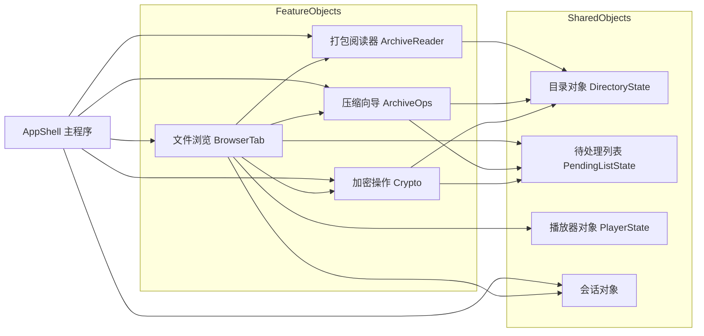
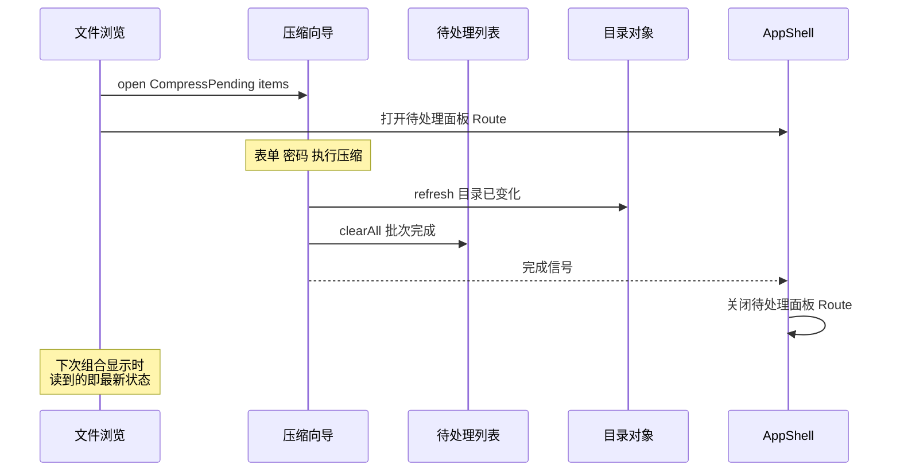

# 主界面 AppShell 分层设计文档

## 1. 设计目的

分层改造的 Phase 3（批次 A-D）已经完成：打包阅读器、压缩向导、Crypto、待处理列表四批功能各自收敛成了独立文件与工作流对象，`FileBrowserApp.kt` 从 14874 行降到 11242 行。但检视改造后的主函数（2856-5075 行，2220 行的 Composable 作用域，60 个 remember、28 个 LaunchedEffect），会发现它仍然理解一切功能细节。三个具体的越界证据：

1. `pendingList`（待处理文件列表）住在主函数作用域。压缩向导和 Crypto 的执行块完成批量操作后直接调用 `finishPendingListAndReturn()`——两个与文件浏览无关的功能，直接操作文件浏览的内部状态。
2. `executeArchiveOperation()`（258 行文件操作编排）住在主函数里。解压到哪、怎么压缩、进度怎么走，全是 archive 域的内部实现。
3. `refreshTrigger++` 散布在各域执行块里。每个功能完成后直接修改主程序的显示协调变量。

也就是说，批次 A-D 把散装状态捆成了对象（"理顺了房间"），但所有对象仍在同一个 Composable 作用域里创建，彼此之间、与主程序之间没有墙。主程序没有真正聚焦在"显示一个主界面，不关心具体是什么功能"这个问题上。

本文的目标是给出主程序的目标形态：主程序持有每个 Tab 都要用的基本信息（程序启动参数、当前路径等），而每个功能——文件浏览、打包阅读、压缩向导、加密操作——是一个独立的对象，功能内部怎么显示、怎么修改内容，对主程序不可见，对无关的功能也不可见。这是一次重构，不是新功能：所有既有行为保持等价，改变的是代码的所有权与可见性边界。

设计基线：Phase 3 批次 A-D 完成后的工作区（未提交）。上承《主界面 Tab 与 Route 分层改造方案》的 Phase 2 条目，其"AppShell 化"正是本文要展开的内容。

## 2. 设计逻辑

### 2.1 基本假设：单活动原则

本应用有一个贯穿性的行为事实：**任何一个时刻，只有一个功能在起作用，其他功能并不在后台活动。** 即便是 FTP、家庭网络这类后台服务，也是在启动其他功能时被关闭的。用户打开一个打包文件时，文件浏览不在跑；压缩向导执行时，阅读器不在跑；一切 Route 都是模态的——要么覆盖屏幕，要么以对话框形式独占交互。

这个事实是全部协作模型的设计凭借。如果多个功能会并行活动，我们就需要广播、订阅、事件总线这类机制让它们保持一致；但单活动原则下，**不存在"随时通知所有模块状态更新"的需求**。于是协作可以退化为最简单的形式：直接调用。

### 2.2 从假设推出协作模型：一组全局对象，命令式协作

基于单活动原则，程序的目标形态是：**一组全局对象，每个对象封装一个独立功能的状态与操作。** 功能之间没有关系，就互相看不见；有关系，就调用具体对象的函数去更新它的状态。

用两个真实场景说明这个模型：

**场景一：文件浏览创建播放列表。** 用户在文件浏览里长按选了一批音频，选择"加入播放"。在对象模型下，文件浏览做的事只有一件：把参数（文件列表）告知播放器对象——调用 `player.setPlaylist(files)`。播放器对象的内容就更新了。下次播放器出现在屏幕上（Tab 切换或 Route 进入），显示的就是新的列表。文件浏览不知道播放器内部怎么存、怎么排；播放器也不知道这批文件从哪来。

**场景二：压缩向导完成批量压缩。** 向导对象执行完压缩，目录里多了新文件。它做的事是调用目录对象的刷新方法 `directory.refresh()`，再对待处理列表对象调用 `pendingList.clearAll()`。下次文件浏览出现在屏幕上，重新读的就是最新的目录状态。

第二个场景揭示了目录状态的处理原则：**不需要持续同步目录**。每次操作更新完目录后调用一次刷新，任何功能下次启动时读到的自然是最新的目录状态。目录内容不是"被推送的快照"，而是"用时读取的现状"。

某些功能带有缓存（如打包阅读器的解压缓存）。缓存需要知道自己是否过期——本应用现有的解压缓存已经用 mtime 比对实现了自动失效（`ts >= mtime` 即有效），不需要显式失效钩子；但如果未来出现需要显式失效的缓存，模型里天然有它的位置：缓存所属的对象暴露一个失效方法，操作方在改写相关数据后调用它即可，与 `directory.refresh()` 同构。

### 2.3 与 Compose 的映射：组合即投影

上述模型是命令式的（调用方法更新状态），而 Compose 是声明式的（状态变化触发重组）。两者的衔接点是 `mutableStateOf`：

- 全局对象的字段用 `mutableStateOf` 承载；
- 对象的方法更新这些字段时，Compose 自动把依赖该字段的组合标记为待重组；
- 因此"下次它出现在屏幕上，就是按新的数据显示"——这句话不是需要我们实现的承诺，而是 Compose 重组机制的直接语义。

由此得到界面的定义：**界面是对象状态在某一时刻的组合投影。** 每次组合（composition）把几个对象按当前 Route 组合起来，显示出可见的内容；视图层不自持业务状态（只有输入框草稿、滚动位置这类 UI 局部状态），它显示的一切都来自对象。因为状态只存在于对象中，组合只是投影，所以**全局状态始终自洽**——不存在"视图里有一份、对象里有一份"的双份真相。

这也解释了现有批次 A-C 的工作流对象（`ArchiveReaderWorkflowState`、`CryptoWorkflowState` 等）为什么能平滑融入这个模型：它们本来就是"字段用 mutableStateOf、方法更新状态"的类。缺的不是形态，是**所有权与可见性**——它们目前创建于 `FileBrowserApp` 函数作用域，且互相之间共享宿主的散装状态。本设计的迁移工作主要是把所有权与边界补齐，而不是发明新的对象形态。

### 2.4 对象清单与两类对象

把当前主函数作用域里的状态按"谁读谁写"归类后，对象分成两类，依赖方向由此确定：

**共享数据对象**——多个功能都要读写的低层数据，不依赖任何功能对象：

| 对象 | 承载的状态 | 来源（现状） |
| --- | --- | --- |
| 目录对象 `DirectoryState` | rootUri、当前路径 displayUri、刷新信号 | 主函数里的 `rootUri`、`displayUri`、`refreshTrigger` |
| 待处理列表对象 `PendingListState` | 待处理文件集合 | 主函数里的 `pendingList` |
| 播放器对象 `PlayerState` | 播放列表、播放状态 | `playbackState` 等 |
| 会话对象 | 启动参数、pendingIntent 等程序级输入 | 主函数开头的一组解析 |

**功能对象**——一个功能的全部工作流状态与操作，可引用共享数据对象：

| 对象 | 入口 | 来源（现状） |
| --- | --- | --- |
| 文件浏览 `BrowserTab` | 视图入口（读目录对象渲染） | `DirectoryTabRoute` 调用块、文件浏览器、待处理面板 |
| 打包阅读器 `ArchiveReader` | `open(kind, file)` | `ArchiveReaderWorkflowState`（已有） |
| 压缩向导 `ArchiveOps` | `open(request)` | `ArchiveOperationWorkflowState`（已有） |
| 加密操作 `Crypto` | `open(request)` | `CryptoWorkflowState`（已有） |
| 配置导入导出 `ConfigIO` | `open(...)` | `ConfigImportExportWorkflowState`（已有） |

对象之间的关系（箭头 = 调用方向）如下。文件浏览是多数功能的发起者（长按菜单、点击文件）；各功能完成后回写共享数据对象；AppShell 只做组合与路由：



### 2.5 依赖方向与无环规则

上节的关系图隐含一条设计规则：**功能对象可以调用共享数据对象，功能对象之间只允许"发起"方向的单向调用，回写一律落在共享数据对象上。**

这条规则解决的是依赖成环问题。批量压缩的输入来自待处理列表，完成后待处理列表要清空——如果向导对象回写时调用文件浏览对象（"把你的面板关掉"），而文件浏览又要调用向导对象（"打开向导"），两者互相持有引用，环就形成了。规则的解法是拆掉"待处理列表属于文件浏览"这个隐含假设：待处理列表独立为共享数据对象（文件浏览增删项、向导与加密操作完成后清空），而"关闭待处理面板"是**导航**行为——面板开或关是一个 Route 事实，归 AppShell 管。向导对象执行完毕后，AppShell 负责把面板 Route 关掉。

一次批量压缩的完整协作链如下（时序上验证无环规则）：



AppShell 在这条链里只出现两次：接受路由请求、关闭面板。它不知道压缩怎么执行、密码怎么验证，也不需要知道。

### 2.6 目录对象：机制不变，所有权改变

有一个容易误判的点需要专门说明：目录对象的 `refresh()` 与现状的 `refreshTrigger++` 在**机制上是一回事**（内部都是一个触发重读的计数信号），区别在所有权与可见性。现状里 `refreshTrigger` 是主函数的公共变量，任何域的执行块都能 `++` 它，主函数必须把它层层传递给文件浏览的列表加载逻辑；目标形态里这个信号是目录对象的**私有实现**，外部只见 `refresh()` 方法——至于内部是计数器还是直接重读，是对象自己的事。这就是封装的意义：不是换机制，是收所有权。同理，`displayUri` 的读写散布在各处（操作完成跳转、Tab 切换、面包屑导航），收进目录对象后，"当前路径"成为有唯一属主的状态，其他对象通过 `directory.currentUri` 读取、通过导航方法修改。

### 2.7 概念空间

以上推理引入的概念汇总如下，后文与迁移工作均基于这组概念：

* **单活动原则**：任一时刻至多一个功能在活动，后台服务在启动其他功能时关闭。全部协作模型的设计凭借。
* **全局对象**：程序级唯一、有状态的功能封装。字段用 Compose State 承载，方法更新状态。分两类：**共享数据对象**（低层数据，被多方读写，不依赖功能对象）与**功能对象**（一个功能的全部工作流，可引用共享数据对象）。
* **命令式协作**：A 功能改变了 B 关心的数据时，A 调用 B 对象的方法，而非 B 观察 A。回写一律落在共享数据对象上。
* **组合即投影**：界面是对象状态按当前 Route 的瞬时组合显示，视图不增加业务状态副本，全局状态自洽。
* **Route**：导航层概念（沿批次 A 的定义）：目的地记录。Route 状态归 AppShell，功能对象通过请求（或完成信号）让 AppShell 切换 Route，不直接改 Route。

## 3. 核心数据结构

重构的核心数据结构是对象容器的组织。AppShell 顶层创建全部对象，一次性成型：

```kotlin
// AppShell 顶层（替代现在 FileBrowserApp 主函数里的散装 remember）
val session = rememberSessionState(activityIntent)      // 启动参数等程序级输入
val directory = rememberDirectoryState()                // rootUri / 当前路径 / refresh
val pendingList = rememberPendingListState()            // 待处理文件集合
val player = rememberPlayerState()                      // 播放列表与播放状态
val archiveReader = rememberArchiveReaderWorkflow()     // 已有
val archiveOps = rememberArchiveOperationWorkflow(...)  // 已有
val crypto = rememberCryptoWorkflow()                   // 已有
val configIO = rememberConfigImportExportWorkflow(...)  // 已有
```

各共享数据对象的关键成员（示意，不穷举）：

```kotlin
class DirectoryState {
    var rootUri by mutableStateOf<String?>(null); private set
    var currentUri by mutableStateOf("")               // 当前路径，跨 Tab 共读
    fun refresh()                                      // 标记目录已变化，下次读最新
    fun navigateTo(uri: String)                        // 修改当前路径
}
class PendingListState {
    val items = mutableStateListOf<DocumentFileModel>()
    fun add(item) / remove(item) / clearAll()
}
```

功能对象的数据结构即各域工作流状态机（批次 A-C 文档已建模），本设计不重复，只补充它们的引用注入：功能对象构造时拿到共享数据对象（如 `ArchiveOps(directory, pendingList)`），执行完成时调用其方法，不再触碰宿主的任何变量。

## 4. 接口定义

本设计的接口面分三层。

**共享数据对象的公开面**（被功能对象调用）：

```kotlin
// 目录对象
directory.refresh()                 // 操作完成后目录已变化
directory.navigateTo(uri)           // 导航到某目录
directory.currentUri / rootUri      // 读取当前位置（属性）

// 待处理列表对象
pendingList.add(item); pendingList.remove(item)
pendingList.clearAll()              // 批次操作完成后清空

// 播放器对象
player.setPlaylist(files, title)    // 文件浏览（或任何入口）设置播放列表
```

**功能对象的入口面**（被发起方调用，多数已有）：

```kotlin
archiveReader.open(kind, file)             // 打开一个打包类型文件
archiveOps.open(request)                  // 发起解压/压缩向导
crypto.open(request)                      // 发起加解密/密码保护操作
```

**AppShell 对功能对象的组合面**（本设计新增的结构性接口，MainTabFeature）：

每个独立 tab 功能向主程序提供统一的呈现接口，主程序对子功能内部结构（状态类、屏幕、对话框）零感知：

```kotlin
interface MainTabFeature {
    val tab: MainTab
    val content: @Composable () -> Unit   // tab 激活时组合；组合即进入，离开组合即离开
    val overlay: (@Composable () -> Unit)? get() = null  // 跨 tab 显示的对话框级投影
}
```

配套约定：

- **进入/离开无钩子**：组合即投影，功能需要感知进出时在 content 内部用 DisposableEffect 自理，不设 enter/leave 接口函数；
- **工厂是唯一创建入口**：如 `playerTabFeature(deps): PlayerTabFeature`，创建、常驻接线（collect）、快捷方式恢复全部内聚于工厂，主程序不可见；
- **实现类 private**：State 类降为文件私有，主程序与其他域只见接口（呈现接口 + 域间窄 API）；
- **功能一律按有状态对象设计**（状态集可为空）：无状态功能（如速记：进入读文件、离开写回）也做成功能对象，避免日后加 cache 时改形态牵连调用方；有生命周期判据优先于当前状态量。

三层的协作关系总结：**发起方调用功能对象的入口；功能对象执行，完成后回写共享数据对象并发出完成信号；AppShell 收到信号收尾 Route；任何视图下次组合显示时读到的即最新状态。**

### 4.1 关联的判定规则（共识，2026-09）

架构目标是**减少无意义关联，不是杜绝关联**。三条判定：

1. **替换成本检验**：换掉功能 B 时，消费方 A 改的应是"这个功能点消失"（删一处调用），而非牵连无关代码。前者是有意义关联（如文件浏览调播放器建播放列表——A 只看到调用与参数，保存/播放/维护封装在 B 内部），后者是无意义关联（本设计要消解的）。
2. **窄面与方向性**：域间调用 = 具体对象的具体方法，调用面即该域的 API 文档；依赖图保持无环或近无环，不借道主程序中转。
3. **有数据才对象化，工具函数除外**：有生命周期的状态 → 功能对象；纯计算无归属（`dedupeAudioList` 等）→ 模块私有顶层函数（公共库），不为整齐硬造对象。

## 5. 迁移路径

迁移按四步推进，每步行为等价、可独立编译提交审查：

1. **Step 1 对象升格与收口**：把 `rootUri`/`displayUri`/`refreshTrigger`/`pendingList` 收进 `DirectoryState` 与 `PendingListState`；各域执行块里的 `refreshTrigger++`、`finishPendingListAndReturn()` 替换为对象方法调用。此步触碰面广但机械（全局替换 + 编译驱动）。（已完成）
2. **Step 2 文件浏览模块化**：主函数里目录 Tab 的内容块（`DirectoryTabRoute` 调用、文件浏览器、待处理面板、删除确认）整体迁入 `BrowserTab` 模块文件，只暴露视图入口与路由请求出口；`pendingBatchDetails` 等随之内聚。（已完成，BrowserTabHost.kt）
3. **Step 3 各 Route 宿主自治**：`executeArchiveOperation()` 下沉进 archive 域（所需输入——当前目录、root、进度、取消——全部参数化或来自共享对象）；`archiveReader`/`archiveOps`/`crypto` 的创建点上移到 AppShell 顶层，RouteHost 自持所需对象引用。（进行中）
4. **Step 4 AppShell 成型**：主函数收敛为"会话 + 对象创建 + Tab/Route 路由 + 组合"，目标 200-300 行。`FileBrowserApp.kt` 剩余的通用组件（密码输入框、进度对话框等）逐个认领归属文件。

**速记族 / 网络服务族 / Config 域已按同一模式落地**（2026-09）：`NoteTabFeature.kt`（速记+书摘：controller 创建、密码对话框 overlay、退出持久化内聚；书摘向 transient/archive 域提供读写投影接口）；`NetworkServicesTabFeature.kt`（FTP/WebUI/家庭网络：三服务 manager、共享配置、5 个生命周期 effect 内聚，familyNetworkManager 作为共享服务暴露给公告转发流）；`ConfigTabFeature.kt`（设置项 prefs 镜像、四个设置对话框 overlay、导入导出 workflow 创建内聚，workflow 经接口暴露给 browser 域消费）。GIT_SHARE/GIT_PROJECTS/QUICK_CRYPTO/DICTIONARY/ABOUT 的 Route 已自治，`mainTabFeature` 适配即终态。全部平移 token diff=0。

**BrowserTab 域收尾完成**（2026-09，批次 E）：`FileBrowserScreen.kt`（文件浏览器屏幕 + EXIF 元数据/外部打开/文件搜索等 51 个配套顶层符号自 FileBrowserApp.kt 平移，编译驱动收敛跨文件可见性，共享符号 internal 化）；`BrowserTabFeature.kt`（`rememberBrowserTabState` 工厂内聚 root 恢复/初始路径/过滤/隐藏/外开偏好五组 prefs 接线 + `browserTabFeature` 呈现工厂；`state` 投影目录域共享数据对象，宿主与各域命令式直呼）；`openRecentItemByType`/`buildRecentModel`/`RECENT_TYPE_*` 出口重排至 `RecentTabRoute.kt`（RECENT 域事实源）。全部 token 等价验证 + 真机目录/最近/打开链路验证通过。主函数 7480 → 3997 行。

**播放器域已按终态模式落地**（2026-09，作为第二标杆）：`PlaybackScreen.kt`（重投影，实现不依赖状态对象）+ `PlayerTabState.kt`（`PlayerTabFeature` 接口 + private State + `@Composable` 工厂内聚接线/快捷方式恢复/域对话框 overlay）。主程序持 `MainTabFeature` 列表循环组合，`MainTabContentHost` 从 15 参数 content-lambda 路由改为 features 驱动，14 个 tab 平移 token diff=0。其余 tab 域（FTP、Config、速记等）按同一模式逐个工厂化。

## 6. 否决的备选方案

**观察者与事件总线**（目录版本号 + 各模块订阅）：这是为多模块并行监听设计的机制。单活动原则下不存在并行监听场景，引入它的代价是时序复杂度（订阅生命周期对齐、重组风暴、事件顺序）却换不来任何正确性收益。命令式直呼在单活动前提下覆盖全部需求。

**全局单向数据流 store**（Redux/MVVI 式集中状态 + action 分发）：把"调用对象方法"换成"分发 action 给全局 store"，主程序必须理解所有 action 类型，与"主程序不关心具体功能"的目标背道而驰；且 action 间接层在单活动前提下没有解决的真问题。

**维持现状（Composable 作用域内捆 workflow）**：批次 A-D 的形态。状态虽已按域成捆，但创建点、协作变量、编排函数都留在主函数作用域，边界靠纪律维持，随时可被下一处 `finishPendingListAndReturn()` 式调用穿透。

## 7. 变更历史

- 2026-09：确立 MainTabFeature 呈现接口与关联判定规则（§4/§4.1）；播放器域按终态模式分离（PlaybackScreen.kt + PlayerTabState.kt 工厂），14 tab 迁移 features 驱动（token diff=0）。
- 2026-09（二）：速记族、网络服务族、Config 域三批工厂化；主函数仅剩 7 个薄壳 tab 与 BrowserTab 域收尾。
- 2026-09（三）：BrowserTab 域收尾（批次 E）：FileBrowserScreen 平移、rememberBrowserTabState/browserTabFeature 工厂、RECENT 出口重排；主函数降至 3997 行。

| 日期 | 变更原因和内容 |
| --- | --- |
| 2026-09-14 | 初版：基于单活动原则建立全局对象协作模型，给出 AppShell 目标形态与四步迁移路径 |
