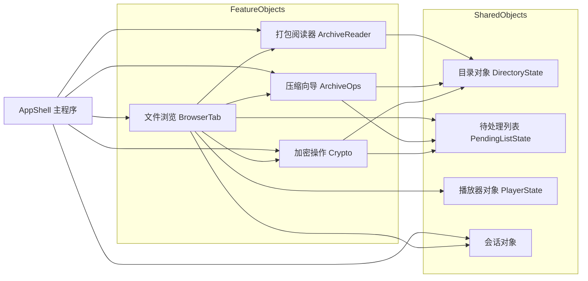
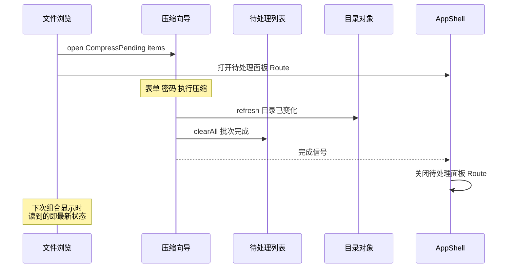

# 主界面 AppShell 分层设计文档

## 1. 设计目的

分层改造的 Phase 3（批次 A-D）已经完成：打包阅读器、压缩向导、Crypto、待处理列表四批功能各自收敛成了独立文件与工作流对象，`FileBrowserApp.kt`（现 `PlataleaApp.kt`，主程序 2026-09 更名）从 14874 行降到 11242 行。但检视改造后的主函数（2856-5075 行，2220 行的 Composable 作用域，60 个 remember、28 个 LaunchedEffect），会发现它仍然理解一切功能细节。三个具体的越界证据：

1. `pendingList`（待处理文件列表）住在主函数作用域。压缩向导和 Crypto 的执行块完成批量操作后直接调用 `finishPendingListAndReturn()`——两个与文件浏览无关的功能，直接操作文件浏览的内部状态。
2. `executeArchiveOperation()`（258 行文件操作编排）住在主函数里。解压到哪、怎么压缩、进度怎么走，全是 archive 域的内部实现。
3. `refreshTrigger++` 散布在各域执行块里。每个功能完成后直接修改主程序的显示协调变量。

也就是说，批次 A-D 把散装状态捆成了对象（"理顺了房间"），但所有对象仍在同一个 Composable 作用域里创建，彼此之间、与主程序之间没有墙。主程序没有真正聚焦在"显示一个主界面，不关心具体是什么功能"这个问题上。

本文的目标是给出主程序的目标形态：主程序持有每个 Tab 都要用的基本信息（程序启动参数、当前路径等），而每个功能——文件浏览、打包阅读、压缩向导、加密操作——是一个独立的对象，功能内部怎么显示、怎么修改内容，对主程序不可见，对无关的功能也不可见。这是一次重构，不是新功能：所有既有行为保持等价，改变的是代码的所有权与可见性边界。

设计基线：Phase 3 批次 A-D 完成后的工作区（未提交）。上承《主界面 Tab 与 Route 分层改造方案》的 Phase 2 条目，其"AppShell 化"正是本文要展开的内容。

## 2. 设计逻辑

### 2.1 基本假设：单活动原则

本应用有一个贯穿性的行为事实：**任何一个时刻，只有一个功能在起作用，其他功能并不在后台活动。** 即便是 FTP、家庭网络这类后台服务，也是在启动其他功能时被关闭的。用户打开一个打包文件时，文件浏览不在跑；压缩向导执行时，阅读器不在跑；一切 Route 都是模态的——要么覆盖屏幕，要么以对话框形式独占交互。

这个事实是全部协作模型的设计凭借。如果多个功能会并行活动，我们就需要广播、订阅、事件总线这类机制让它们保持一致；但单活动原则下，**不存在"随时通知所有模块状态更新"的需求**。于是协作可以退化为最简单的形式：直接调用。

### 2.2 从假设推出协作模型：一组全局对象，命令式协作

基于单活动原则，程序的目标形态是：**一组全局对象，每个对象封装一个独立功能的状态与操作。** 功能之间没有关系，就互相看不见；有关系，就调用具体对象的函数去更新它的状态。

用两个真实场景说明这个模型：

**场景一：文件浏览创建播放列表。** 用户在文件浏览里长按选了一批音频，选择"加入播放"。在对象模型下，文件浏览做的事只有一件：把参数（文件列表）告知播放器对象——调用 `player.setPlaylist(files)`。播放器对象的内容就更新了。下次播放器出现在屏幕上（Tab 切换或 Route 进入），显示的就是新的列表。文件浏览不知道播放器内部怎么存、怎么排；播放器也不知道这批文件从哪来。

**场景二：压缩向导完成批量压缩。** 向导对象执行完压缩，目录里多了新文件。它做的事是调用目录对象的刷新方法 `directory.refresh()`，再对待处理列表对象调用 `pendingList.clearAll()`。下次文件浏览出现在屏幕上，重新读的就是最新的目录状态。

第二个场景揭示了目录状态的处理原则：**不需要持续同步目录**。每次操作更新完目录后调用一次刷新，任何功能下次启动时读到的自然是最新的目录状态。目录内容不是"被推送的快照"，而是"用时读取的现状"。

某些功能带有缓存（如打包阅读器的解压缓存）。缓存需要知道自己是否过期——本应用现有的解压缓存已经用 mtime 比对实现了自动失效（`ts >= mtime` 即有效），不需要显式失效钩子；但如果未来出现需要显式失效的缓存，模型里天然有它的位置：缓存所属的对象暴露一个失效方法，操作方在改写相关数据后调用它即可，与 `directory.refresh()` 同构。

### 2.3 与 Compose 的映射：组合即投影

上述模型是命令式的（调用方法更新状态），而 Compose 是声明式的（状态变化触发重组）。两者的衔接点是 `mutableStateOf`：

- 全局对象的字段用 `mutableStateOf` 承载；
- 对象的方法更新这些字段时，Compose 自动把依赖该字段的组合标记为待重组；
- 因此"下次它出现在屏幕上，就是按新的数据显示"——这句话不是需要我们实现的承诺，而是 Compose 重组机制的直接语义。

由此得到界面的定义：**界面是对象状态在某一时刻的组合投影。** 每次组合（composition）把几个对象按当前 Route 组合起来，显示出可见的内容；视图层不自持业务状态（只有输入框草稿、滚动位置这类 UI 局部状态），它显示的一切都来自对象。因为状态只存在于对象中，组合只是投影，所以**全局状态始终自洽**——不存在"视图里有一份、对象里有一份"的双份真相。

这也解释了现有批次 A-C 的工作流对象（`ArchiveReaderWorkflowState`、`CryptoWorkflowState` 等）为什么能平滑融入这个模型：它们本来就是"字段用 mutableStateOf、方法更新状态"的类。缺的不是形态，是**所有权与可见性**——它们目前创建于 `FileBrowserApp` 函数作用域，且互相之间共享宿主的散装状态。本设计的迁移工作主要是把所有权与边界补齐，而不是发明新的对象形态。

### 2.4 对象清单与两类对象

把当前主函数作用域里的状态按"谁读谁写"归类后，对象分成两类，依赖方向由此确定：

**共享数据对象**——多个功能都要读写的低层数据，不依赖任何功能对象：

| 对象 | 承载的状态 | 来源（现状） |
| --- | --- | --- |
| 目录对象 `DirectoryState` | rootUri、当前路径 displayUri、刷新信号 | 主函数里的 `rootUri`、`displayUri`、`refreshTrigger` |
| 待处理列表对象 `PendingListState` | 待处理文件集合 | 主函数里的 `pendingList` |
| 播放器对象 `PlayerState` | 播放列表、播放状态 | `playbackState` 等 |
| 会话对象 | 启动参数、pendingIntent 等程序级输入 | 主函数开头的一组解析 |

**功能对象**——一个功能的全部工作流状态与操作，可引用共享数据对象：

| 对象 | 入口 | 来源（现状） |
| --- | --- | --- |
| 文件浏览 `BrowserTab` | 视图入口（读目录对象渲染） | `BrowserTabRoute` 调用块、浏览器屏幕、待处理面板 |
| 打包阅读器 `ArchiveReader` | `open(kind, file)` | `ArchiveReaderWorkflowState`（已有） |
| 压缩向导 `ArchiveOps` | `open(request)` | `ArchiveOperationWorkflowState`（已有） |
| 加密操作 `Crypto` | `open(request)` | `CryptoWorkflowState`（已有） |
| 配置导入导出 `ConfigIO` | `open(...)` | `ConfigImportExportWorkflowState`（已有） |

对象之间的关系（箭头 = 调用方向）如下。文件浏览是多数功能的发起者（长按菜单、点击文件）；各功能完成后回写共享数据对象；AppShell 只做组合与路由：



### 2.5 依赖方向与无环规则

上节的关系图隐含一条设计规则：**功能对象可以调用共享数据对象，功能对象之间只允许"发起"方向的单向调用，回写一律落在共享数据对象上。**

这条规则解决的是依赖成环问题。批量压缩的输入来自待处理列表，完成后待处理列表要清空——如果向导对象回写时调用文件浏览对象（"把你的面板关掉"），而文件浏览又要调用向导对象（"打开向导"），两者互相持有引用，环就形成了。规则的解法是拆掉"待处理列表属于文件浏览"这个隐含假设：待处理列表独立为共享数据对象（文件浏览增删项、向导与加密操作完成后清空），而"关闭待处理面板"是**导航**行为——面板开或关是一个 Route 事实，归 AppShell 管。向导对象执行完毕后，AppShell 负责把面板 Route 关掉。

一次批量压缩的完整协作链如下（时序上验证无环规则）：



AppShell 在这条链里只出现两次：接受路由请求、关闭面板。它不知道压缩怎么执行、密码怎么验证，也不需要知道。

### 2.6 目录对象：机制不变，所有权改变

有一个容易误判的点需要专门说明：目录对象的 `refresh()` 与现状的 `refreshTrigger++` 在**机制上是一回事**（内部都是一个触发重读的计数信号），区别在所有权与可见性。现状里 `refreshTrigger` 是主函数的公共变量，任何域的执行块都能 `++` 它，主函数必须把它层层传递给文件浏览的列表加载逻辑；目标形态里这个信号是目录对象的**私有实现**，外部只见 `refresh()` 方法——至于内部是计数器还是直接重读，是对象自己的事。这就是封装的意义：不是换机制，是收所有权。同理，`displayUri` 的读写散布在各处（操作完成跳转、Tab 切换、面包屑导航），收进目录对象后，"当前路径"成为有唯一属主的状态，其他对象通过 `directory.currentUri` 读取、通过导航方法修改。

### 2.7 概念空间

以上推理引入的概念汇总如下，后文与迁移工作均基于这组概念：

* **单活动原则**：任一时刻至多一个功能在活动，后台服务在启动其他功能时关闭。全部协作模型的设计凭借。
* **全局对象**：程序级唯一、有状态的功能封装。字段用 Compose State 承载，方法更新状态。分两类：**共享数据对象**（低层数据，被多方读写，不依赖功能对象）与**功能对象**（一个功能的全部工作流，可引用共享数据对象）。
* **命令式协作**：A 功能改变了 B 关心的数据时，A 调用 B 对象的方法，而非 B 观察 A。回写一律落在共享数据对象上。
* **组合即投影**：界面是对象状态按当前 Route 的瞬时组合显示，视图不增加业务状态副本，全局状态自洽。
* **Route**：导航层概念（沿批次 A 的定义）：目的地记录。Route 状态归 AppShell，功能对象通过请求（或完成信号）让 AppShell 切换 Route，不直接改 Route。

## 3. 核心数据结构

重构的核心数据结构是对象容器的组织。AppShell 顶层创建全部对象，一次性成型：

```kotlin
// AppShell 顶层（替代现在 FileBrowserApp 主函数里的散装 remember）
val session = rememberSessionState(activityIntent)      // 启动参数等程序级输入
val directory = rememberDirectoryState()                // rootUri / 当前路径 / refresh
val pendingList = rememberPendingListState()            // 待处理文件集合
val player = rememberPlayerState()                      // 播放列表与播放状态
val archiveReader = rememberArchiveReaderWorkflow()     // 已有
val archiveOps = rememberArchiveOperationWorkflow(...)  // 已有
val crypto = rememberCryptoWorkflow()                   // 已有
val configIO = rememberConfigImportExportWorkflow(...)  // 已有
```

各共享数据对象的关键成员（示意，不穷举）：

```kotlin
class DirectoryState {
    var rootUri by mutableStateOf<String?>(null); private set
    var currentUri by mutableStateOf("")               // 当前路径，跨 Tab 共读
    fun refresh()                                      // 标记目录已变化，下次读最新
    fun navigateTo(uri: String)                        // 修改当前路径
}
class PendingListState {
    val items = mutableStateListOf<DocumentFileModel>()
    fun add(item) / remove(item) / clearAll()
}
```

功能对象的数据结构即各域工作流状态机（批次 A-C 文档已建模），本设计不重复，只补充它们的引用注入：功能对象构造时拿到共享数据对象（如 `ArchiveOps(directory, pendingList)`），执行完成时调用其方法，不再触碰宿主的任何变量。

## 4. 接口定义

本设计的接口面分三层。

**共享数据对象的公开面**（被功能对象调用）：

```kotlin
// 目录对象
directory.refresh()                 // 操作完成后目录已变化
directory.navigateTo(uri)           // 导航到某目录
directory.currentUri / rootUri      // 读取当前位置（属性）

// 待处理列表对象
pendingList.add(item); pendingList.remove(item)
pendingList.clearAll()              // 批次操作完成后清空

// 播放器对象
player.setPlaylist(files, title)    // 文件浏览（或任何入口）设置播放列表
```

**功能对象的入口面**（被发起方调用，多数已有）：

```kotlin
archiveReader.open(kind, file)             // 打开一个打包类型文件
archiveOps.open(request)                  // 发起解压/压缩向导
crypto.open(request)                      // 发起加解密/密码保护操作
```

**AppShell 对功能对象的组合面**（本设计新增的结构性接口，MainTabFeature）：

每个独立 tab 功能向主程序提供统一的呈现接口，主程序对子功能内部结构（状态类、屏幕、对话框）零感知：

```kotlin
interface MainTabFeature {
    val tab: MainTab
    val content: @Composable () -> Unit   // tab 激活时组合；组合即进入，离开组合即离开
    val overlay: (@Composable () -> Unit)? get() = null  // 跨 tab 显示的对话框级投影
}
```

配套约定：

- **进入/离开无钩子**：组合即投影，功能需要感知进出时在 content 内部用 DisposableEffect 自理，不设 enter/leave 接口函数；
- **工厂是唯一创建入口**：如 `playerTabFeature(deps): PlayerTabFeature`，创建、常驻接线（collect）、快捷方式恢复全部内聚于工厂，主程序不可见；
- **实现类 private**：State 类降为文件私有，主程序与其他域只见接口（呈现接口 + 域间窄 API）；
- **功能一律按有状态对象设计**（状态集可为空）：无状态功能（如速记：进入读文件、离开写回）也做成功能对象，避免日后加 cache 时改形态牵连调用方；有生命周期判据优先于当前状态量。

三层的协作关系总结：**发起方调用功能对象的入口；功能对象执行，完成后回写共享数据对象并发出完成信号；AppShell 收到信号收尾 Route；任何视图下次组合显示时读到的即最新状态。**

### 4.1 关联的判定规则（共识，2026-09）

架构目标是**减少无意义关联，不是杜绝关联**。三条判定：

1. **替换成本检验**：换掉功能 B 时，消费方 A 改的应是"这个功能点消失"（删一处调用），而非牵连无关代码。前者是有意义关联（如文件浏览调播放器建播放列表——A 只看到调用与参数，保存/播放/维护封装在 B 内部），后者是无意义关联（本设计要消解的）。
2. **窄面与方向性**：域间调用 = 具体对象的具体方法，调用面即该域的 API 文档；依赖图保持无环或近无环，不借道主程序中转。
3. **有数据才对象化，工具函数除外**：有生命周期的状态 → 功能对象；纯计算无归属（`dedupeAudioList` 等）→ 模块私有顶层函数（公共库），不为整齐硬造对象。

## 5. 迁移路径

迁移按四步推进，每步行为等价、可独立编译提交审查：

1. **Step 1 对象升格与收口**：把 `rootUri`/`displayUri`/`refreshTrigger`/`pendingList` 收进 `DirectoryState` 与 `PendingListState`；各域执行块里的 `refreshTrigger++`、`finishPendingListAndReturn()` 替换为对象方法调用。此步触碰面广但机械（全局替换 + 编译驱动）。（已完成）
2. **Step 2 文件浏览模块化**：主函数里目录 Tab 的内容块（`DirectoryTabRoute` 调用、文件浏览器、待处理面板、删除确认）整体迁入 `BrowserTab` 模块文件，只暴露视图入口与路由请求出口；`pendingBatchDetails` 等随之内聚。（已完成，BrowserTabHost.kt）
3. **Step 3 各 Route 宿主自治**：`executeArchiveOperation()` 下沉进 archive 域（所需输入——当前目录、root、进度、取消——全部参数化或来自共享对象）；`archiveReader`/`archiveOps`/`crypto` 的创建点上移到 AppShell 顶层，RouteHost 自持所需对象引用。（进行中）
4. **Step 4 AppShell 成型**：主函数收敛为"会话 + 对象创建 + Tab/Route 路由 + 组合"，目标 200-300 行。`FileBrowserApp.kt` 剩余的通用组件（密码输入框、进度对话框等）逐个认领归属文件。

**速记族 / 网络服务族 / Config 域已按同一模式落地**（2026-09）：`NoteTabFeature.kt`（速记+书摘：controller 创建、密码对话框 overlay、退出持久化内聚；书摘向 transient/archive 域提供读写投影接口）；`NetworkServicesTabFeature.kt`（FTP/WebUI/家庭网络：三服务 manager、共享配置、5 个生命周期 effect 内聚，familyNetworkManager 作为共享服务暴露给公告转发流）；`ConfigTabFeature.kt`（设置项 prefs 镜像、四个设置对话框 overlay、导入导出 workflow 创建内聚，workflow 经接口暴露给 browser 域消费）。GIT_SHARE/GIT_PROJECTS/QUICK_CRYPTO/DICTIONARY/ABOUT 的 Route 已自治，`mainTabFeature` 适配即终态。全部平移 token diff=0。

**BrowserTab 域收尾完成**（2026-09，批次 E）：`FileBrowserScreen.kt`（现 `BrowserScreen.kt`）（文件浏览器屏幕 + EXIF 元数据/外部打开/文件搜索等 51 个配套顶层符号自 FileBrowserApp.kt 平移，编译驱动收敛跨文件可见性，共享符号 internal 化）；`BrowserTabFeature.kt`（`rememberBrowserTabState` 工厂内聚 root 恢复/初始路径/过滤/隐藏/外开偏好五组 prefs 接线 + `browserTabFeature` 呈现工厂；`state` 投影目录域共享数据对象，宿主与各域命令式直呼）；`openRecentItemByType`/`buildRecentModel`/`RECENT_TYPE_*` 出口重排至 `RecentTabRoute.kt`（RECENT 域事实源）。全部 token 等价验证 + 真机目录/最近/打开链路验证通过。主函数 7480 → 3997 行。

**播放器域已按终态模式落地**（2026-09，作为第二标杆）：`PlaybackScreen.kt`（重投影，实现不依赖状态对象）+ `PlayerTabState.kt`（`PlayerTabFeature` 接口 + private State + `@Composable` 工厂内聚接线/快捷方式恢复/域对话框 overlay）。主程序持 `MainTabFeature` 列表循环组合，`MainTabContentHost` 从 15 参数 content-lambda 路由改为 features 驱动，14 个 tab 平移 token diff=0。其余 tab 域（FTP、Config、速记等）按同一模式逐个工厂化。

## 6. 否决的备选方案

**观察者与事件总线**（目录版本号 + 各模块订阅）：这是为多模块并行监听设计的机制。单活动原则下不存在并行监听场景，引入它的代价是时序复杂度（订阅生命周期对齐、重组风暴、事件顺序）却换不来任何正确性收益。命令式直呼在单活动前提下覆盖全部需求。

**全局单向数据流 store**（Redux/MVVI 式集中状态 + action 分发）：把"调用对象方法"换成"分发 action 给全局 store"，主程序必须理解所有 action 类型，与"主程序不关心具体功能"的目标背道而驰；且 action 间接层在单活动前提下没有解决的真问题。

**维持现状（Composable 作用域内捆 workflow）**：批次 A-D 的形态。状态虽已按域成捆，但创建点、协作变量、编排函数都留在主函数作用域，边界靠纪律维持，随时可被下一处 `finishPendingListAndReturn()` 式调用穿透。

## 7. 变更历史

- 2026-09：确立 MainTabFeature 呈现接口与关联判定规则（§4/§4.1）；播放器域按终态模式分离（PlaybackScreen.kt + PlayerTabState.kt 工厂），14 tab 迁移 features 驱动（token diff=0）。
- 2026-09（二）：速记族、网络服务族、Config 域三批工厂化；主函数仅剩 7 个薄壳 tab 与 BrowserTab 域收尾。
- 2026-09（三）：BrowserTab 域收尾（批次 E）：FileBrowserScreen 平移、rememberBrowserTabState/browserTabFeature 工厂、RECENT 出口重排；主函数降至 3997 行。
- 2026-09（四）：批次 F 启动。F1：TabExitRestorePolicy 属性化（网络三 tab 标 TRANSIENT，persistTabChoice/恢复逻辑改问属性，删 isNetworkServiceTab 硬编码；家庭网络前台判定域自持 familyNetworkForeground）。F2：单行转发内联（requestOpenPlayerTab/AboutTab）。F3 骨架+F4 首域（播放器）：新增 ConfigService.kt（配置域服务：唯一创建入口 + 各域窄投影；成员资格判据=是否进统一导出；过渡面 legacy 待逐域替换）；PlayerConfigView 投影接入播放器全链（工厂/State/Route/PlaybackScreen，Preferences 类型从域内清除）；播放器编排函数族（removePlaylistTrackAt/sync/notify×2/createDirectoryPlaylistAndStart）自 FileBrowserApp.kt 迁入域文件；目录建列表经 PlayerTabApi.requestCreateDirectoryPlaylist 出口（编排内聚，browser 域经回调消费）；recent 记录改回调注入。设计对齐：功能身份单数（State/Screen 为内部结构）；配置属于配置域，tab 仅呈现窗口。
- 2026-09（四b）：修复「加入播放挂死」死锁（真机实锤）。根因：FileBrowserScreen 目录滚动记忆的 onDispose 在主线程 runBlocking 同步等待 DataStore edit（a5cc210 引入的历史隐患，与 Main 队列上挂起的编排协程互等；DataStore 官方禁止主线程 runBlocking），旧版仅侥幸未踩中时序窗口，F4 编排内聚后必现。修复：dispose 改 NonCancellable 独立 IO 协程 fire-and-forget；同类隐患 BrowserTabHost.saveBatchEditableAudioAnnotation（IO 线程 runBlocking）顺手 suspend 化；CrashReportStore 启动期 runBlocking 记录在案待观察。验证：新建/追加两分支播放、tab 往返×3、全部无 ANR。
- 2026-09（四c）：F4 browser 域投影完成。BrowserConfigView（rootUri/过滤/隐藏/外开包四读源 + 外开包两写 + 目录滚动记忆三方法 + 音频元数据注解两方法）；BrowserTabState 构造 prefs→config；BrowserTabHost 内建 prefs 清除（外开偏好写/批量元数据对话框链 suspend 化后直接收 config）；FileBrowserScreen 去除函数内自建 Preferences(context)（E1 平移残留，改经 DirectoryTabRouteState 传 config）；宿主接 config.browser。Preferences 类型从 browser 域四文件清除。真机验证：目录 68 节点/子目录浏览/滚动记忆写读闭环（根目录滚后切 tab 再回恢复位置）/播放器 tab 无 ANR。

| 日期 | 变更原因和内容 |
| --- | --- |
| 2026-09-14 | 初版：基于单活动原则建立全局对象协作模型，给出 AppShell 目标形态与四步迁移路径 |
- 2026-09（四d）：命名统一（解决"主程序 vs 浏览 tab"交流歧义）。主程序 FileBrowserApp → PlataleaApp（函数/文件/MainActivity 调用点/logcat tag/平移来源注释）；浏览 tab 域三套前缀收敛为 Browser 系：FileBrowserScreen → BrowserScreen（+文件）、DirectoryTabRoute(State) → BrowserTabRoute(State)（+文件）；MainTab.DIRECTORY 保留（tab 身份与 UI 文案"目录"一致，域实现与 tab 身份两层各自一致）。编译+测试+打包全绿。
- 2026-09（四e）：F4 网络域投影完成。NetworkConfigView（端口/口令/超时/本机服务开关/家庭网络三身份 7 读源 + 7 写方法 + legacy extraRoles 迁移读写）；NetworkServiceConfigState 与 remember 工厂全链 prefs→config（7 collect + 6 set）；networkServicesTabs 构造改 config.network（legacy 迁移块同改）；宿主接线完成。Preferences 类型从网络域两文件清除（FamilyNetworkScreen 内 PdfViewer 自建一处标注 F5 阅读器域待办）。真机验证：FTP tab 快照渲染（地址/运行中）、CONFIG 网络服务分区摘要（密码/开关/倒计时三快照）、用户名写入落盘（DataStore 二进制读证）+ 重启后经投影读回闭环。
- 2026-09（四f）：F4 配置域 + git 域（配置面）投影完成。ConfigEditingView（4 通用设置 + EPUB TTS 5 项读写 + 统一导出/导入/播放列表检查三方法——导出成员资格在投影收口，data 层 ConfigExport 函数不再外漏给 UI）；GitConfigView（git 五成员读写，GitConfigDialog/PubkeyShareScreen 经 config.git 接入）。ConfigTabFeature/ConfigTabRoute（删自建 Preferences + 死代码 ConfigDialog 顺带删除）/ConfigImportExportWorkflow/两 git 对话框全部换投影，Preferences 类型清除。真机验证：过滤开关写落盘+重启读回、Git 配置对话框表单、导出配置全链（根目录生成 local_manager_config.json 后已彻底删除）。
- 2026-09（四g）：F4 git 域（Git tab 本体）完成。GitConfigView 扩充 managedGitProjects 一读三写（项目列表持久化）；GitShareTabRoute（共享到 Git）/GitProjectsTabRoute（Git tab）/FileShareScreen 全部 prefs→config.git，三文件 internal 化，Preferences 类型清除；PlataleaApp 分享到 Git overlay 漏改的凭据读一并换投影。真机验证：Git tab 空态双提示（无基础配置/无受管项目，gitRepoUrl 与 managedGitProjects 两读链）+ GitShare tab .sysgit/share 列表渲染（FileShareScreen 凭据读路径）。
- 2026-09（四h）：F4 词典域完成。DictionaryConfigView（查询历史一读两写）；DictionaryScreen 删函数内自建 Preferences（E1 同形态残留）→ 参数注入，DictionaryTabRoute/宿主全链 config.dictionary，两文件 internal 化。真机验证（用户导入词典后补全）：真实查询 173 词条；recordDictQuery 写路径字节级实证（["test"] 落盘、多条 ["hello","test"] 新词置顶）；clearDictQueryHistory（键从 DataStore 移除 + UI 历史区消失）；force-stop 重启历史恢复（collect 读回）；空态（无词典）与目录 tab 冒烟。TransientRouteHost 的 prefs 转喂 PdfViewerScreen 线留 F5 阅读器域（MarkdownViewerScreen.kt 8800 行巨文件，25 成员投影主体）。
- 2026-09（四i）：F5 阅读器域完成。ReaderConfigView（25 成员：阅读器通用 4+浮动按钮 5+EPUB 朗读 9+EPUB 词典 4+进度缩放 6）；EPUB TTS 5 项从 ConfigEditingView 迁入（对齐 GitConfigDialog 模式：数据归域投影，CONFIG tab 编辑经 config.reader）。MarkdownViewerScreen.kt（10706 行 8 屏：Markdown/MdZip/HtmlZip/Epub/Pdf/PassContent/HtmlViewer + StandaloneWebViewTtsController）六处自建 Preferences 全删改参数注入；TransientRouteHost prefs 参数换 config、ArchiveViewerRouteHost +readerConfig 转三屏、FamilyNetworkScreen 自建删除（1269 行 F5 待办清除）+readerConfig 参数、networkServicesTabs 透传；14 文件 internal 化。真机验证：PDF 进度恢复（3/23→翻页 4/23→重进恢复，URI 键控读写闭环）；MdZip 渲染（通用偏好 collect）；EPUB TTS 迁移闭环（CONFIG 摘要四项显示+速度 100→120 字节级落盘 varint 0x78）。注：速度滑条停在 140%（UI 自动化精度），用户可自行调回 100%。配平脚本对此文件误报 -1（raw string 内 JS 花括号），diff 括号净变化 +0+kotlinc 全绿为准。
- 2026-09（四j）：修复 EPUB/WebView 朗读起点错位（用户报告：拉到顶后朗读从中间段落开始）。诊断（探针实证三缺陷叠加）：① GestureWebView 滚动报告 1% 阈值吞掉终值——拉顶后 ratio 粘滞在 0.009（UI 标签 0~5% 均显示本章开头，掩盖残留）；② resolveTtsStartSegmentIndex 的 +0.01 比例容差对长章过大（17 万 px 高的章 1%≈1700px≈数屏），indexOfLast 取窗口内最后段跳过首屏段落；③ llm 生成的 EPUB 卡片式布局 DOM 顺序≠视觉顺序（探针：DOM 末段 top=163px），乱序列表上起点解析与朗读顺序双双失义。修复：① 报告条件加边界（ratio≤0.001/≥0.999 必报）；② 容差 0.01→0.001（仅消浮点噪声，语义=视口顶所在段）；③ collect 段落按 topRatio 稳定排序（普通 EPUB 无操作）。验证：拉顶 ratio=0/startIdx=首屏段；中部 3.12%→startIdx=17（hitTop=3.18%），修复前同场景 startIdx=311；朗读会话正常启动。三探针已全部移除。
- 2026-09（四k，最终批）：legacy 过渡面删除，主域收编完成。新增 ShellConfigView（AppShell 域投影：lastMainTab/lastNonServerMainTab/recentOpenItems 一读三写——Tab 恢复记忆与 RECENT tab 数据源）；BrowserConfigView 扩根目录三成员（recentRootUris 读 + setRootUri/recordRecentRootSwitch 两写，根目录管理归目录域）；PlataleaApp 删 config.legacy 持有与 Preferences import，13 处消费点分换 config.shell（Tab 持久/恢复、最近打开四操作）/config.browser（根目录切换两处）/config.editing（startupDecryptKey/viewerPreviewBytes 两 collect，通用设置既有投影）。ConfigService 投影面定格：player/browser/quickNote/network/editing/git/dictionary/reader/shell 九域，ui 层 Preferences 直接引用仅剩 ConfigService.kt 投影实现本体——存储类型对全部功能域不可见。
- 2026-09（G1）：Gpg 弹窗族与通用进度件迁出主程序。GpgPasswordDialog/GpgEncryptDialog/GpgMethodDialog/GpgPublicKeyPickerDialog（定义寄居主文件、调用者在 crypto 域四文件）迁入 CryptoDialogs.kt 并 internal 化；通用进度件（OperationProgress/OperationCancelFlag/OperationProgressDialog）独立成 OperationProgressDialogs.kt（通用件不寄居功能域）；isRequiredPasswordConfirmed/PasswordConfirmationFields 提升 internal（G5 再迁）。主程序 3904→3606 行。真机：长按文件→GnuPG 加密→GpgEncryptDialog（新位置）对称+公钥双模式渲染。
- 2026-09（G2）：配置域弹窗独立成 ConfigDialogs.kt。KeyManagementDialog 拆两层：KeyManagementWorkflowState（列表加载/导入导出删除编排，pendingExport 三元组状态）+ Dialog（UI+ActivityResult launcher 接 workflow 回调，对外签名不变零调用方改动）；CacheManagementDialog/GenerateKeyDialog 随迁；PendingDelete sealed class internal 化随迁。主程序 3606→3152 行（含 33 个孤儿 import 清理）。真机：gpg钥匙管理弹窗（workflow 加载公钥 0x39245226、生成/分享/导入/导出按钮）、缓存管理弹窗（57.7MB/2.9MB 两缓存+清空）均从新文件渲染。
- 2026-09（G3）：Browser 域弹窗独立成 BrowserDialogs.kt。BrowserRootSwitchWorkflow（根切换/换根确认弹窗 Route+cachedTrashUri 维护+回收站计数检查+applyNewRoot 记录应用链）与 BrowserSaveWorkflow（外源保存 pending/覆盖确认/复制执行，onSaved 回调注入）两工作流，RootSwitchDialog/ChangeRootConfirmDialog/OverwriteSaveConfirmDialog 纯 UI 参数化；宿主内联 AlertDialog×3 与散装状态组（showRootSwitchDialog/showChangeRootConfirm/cachedTrashUri/pendingSaveFileUri/showOverwriteConfirm/saveInProgress 六变量）删除，SAF treeLauncher 留宿主经注入协作。humanReadableRootUri 提升 internal。主程序 3152→3006 行。真机：菜单更换根目录→对话框渲染→选择新目录→SAF 授权→applyNewRoot 全链回 app 无 crash（同根幂等）。
- 2026-09（G4）：Git 分享独立成 GitShareDialogs.kt。GitShareWorkflowState（target 确认 Route+logs 快照列表+inProgress/done+confirm 全链：读 git 投影配置→cloneToTree→copyFileToShare→commitAndPush，日志逐行追加）与 GitShareDialogs（确认+日志双弹窗，日志滚动跟随错误高亮，rootUri 注入）；宿主四散装状态（shareFileToGitTarget/shareGitLogs/shareGitInProgress/shareGitDone）删除，onShareToGit 回调换 workflow::request。主程序 3006→2891 行。真机：长按文件→共享到 Git→确认弹窗新位置渲染（执行链与原代码逐行同构，未真跑 push 避免仓库副作用）。
- 2026-09（G5，G 系列收批）：快速遮罩与密码输入共享件迁出。QuickObfuscateDialogs.kt（QuickObfuscateWorkflowState 单/批双槽：目标+密码表单+执行链，runWithProgress 与完成回调注入；QuickObfuscatePasswordDialog 随迁 internal 化）与 PasswordFields.kt（isRequiredPasswordConfirmed/isOptionalPasswordConfirmed/PasswordConfirmationFields/ReliablePasswordInputField 及自定义键盘附属件——多域共享件独立文件）；宿主八散装状态（quickMask/batchMask 各四）与双内联调用块删除，onQuickMask/onBatchMask 回调换 workflow。主程序 2891→2403 行，G 系列累计 3904→2403（-1501），弹窗功能全部归域文件，主程序不再含密码框/日志窗/进度窗等功能细节。
- 2026-09（F5 收尾）：两项遗留收编。① markdownViewerSessionCache 查看器域接口化：ViewerSessions.kt（契约 getHtml/putHtml/peekHtml/getWebView/putWebView/setPageReady/isPageReady/invalidate/invalidateByUri/clear + rememberViewerSessions(rootUri) 工厂内聚创建与根切换失效 + rememberLocalViewerSessions 局部工厂）；七处跨文件签名（速记/书摘/目录 deps/Transient/ArchiveViewer/两屏）换接口，直接戳 htmlCache/pageReadyMap 的 5 处换 peekHtml/isPageReady（无副作用语义与原裸读一致），FamilyNetworkScreen 自建改局部工厂，速记/书摘两 Route 函数补 internal；实现类只在 MarkdownViewerScreen.kt。② crypto 收尾：PassEditScreen onSave 的 GPG 重加密写回执行块（~20 行）自 AppShell 下沉 savePassEditReencrypted（CryptoWorkflow.kt，withContext(IO)），宿主只留 close/refresh/toast 编排，4 个 gpg import 随迁。主程序 2403→2385 行。真机：basic.md 开启+二次开启（缓存命中）正常、速记 tab 渲染正常（三处经接口链路）；.pass 编辑链为逐行同构搬移，编译/测试全绿。另：新增 AGENTS.md（助手不得自行 git commit，须用户 review 后提交）。
- 2026-09（崩溃修复）：RECENT 点播放列表闪退。根因（既有 bug，logcat 实证）：所有 UI 入口经 startForegroundService() 启动 PlaybackService，但 onStartCommand 多条分支（播放列表 id 已删→stopSelf、列表空→stopSelf、RESUME 无恢复源→stopSelf、参数缺失→return）从未调 startForeground()，系统 5 秒超时以 RemoteServiceException 杀进程。修复：onStartCommand 顶部无条件 startForeground（一处覆盖全部退出分支，播放中的后续 startForeground 幂等刷新）。真机验证：残留 id 条目→安静退出到 PLAYER 空闲态（无崩溃）；真实列表→正常起播（天边.mp3 1/1）；ACTION_STOP 停播无异常。
- 2026-09（RECENT 残留清理 + 恢复语义修复）：① 最近条目发现即删——openRecentItemWithStaleGuard（RecentTabRoute）：播放列表查 config.player.playlists、文件条目 SAF exists 检查（http/https 不检），不存在/记录残缺→config.shell.removeRecentOpenItem + toast，不再分发打开（此前残缺条目仅 toast 且残留，播放列表条目还会被 recordRecentOpen 顶到最上）；中英文案 recent_stale_removed。② 播放恢复到末尾即完成缺陷——自然完成链 playNext 的 savePosition 把末尾位置存为恢复点（字节级实证 p=286956≈全长），下次打开该列表 seek 到尾秒完成呈"未在播放"；修复：onCompletion 走 playNext(skipSave=true)（前进后 playTrackAtIndex 的 persist 落在新曲开头），列表播完分支 stopPlayback 后恢复点重置 (0,0)。真机：残留播放列表条目点击即从列表消失；有效条目正常打开；播完后 DataStore resume 字节级回 0；同一列表播放中点最近条目继续播放不重启。
- 2026-09-23（ZIP 编辑功能）：新增 file/ZipEditor.kt（纯函数层单测 8 项 + SAF 中转编排，临时文档替换写回）；ui/ZipEditWorkflow+ZipEditDialogs（加入向导三态）+ ZipManagerScreen（条目多选删除）；ConfigService 新增 ZipEditConfigView 投影；BrowserScreen 上下文菜单两项+目标指示条、PendingListScreen 批量动作；编排闭环在 BrowserTabHost 域内（deps 注入投影），PlataleaApp 仅一行接线。详见 docs/ZIP编辑功能设计.md。
- 2026-09-25（ZIP 编辑二轮）：操作目标文件概念通用化（operation_target_uri 键 + OperationTargetConfigView 投影）；任意 zip"编辑 ZIP 内容"直接编辑（ZipManagerSession 会话，ZipManager 顶栏 SAF 添加文件）；上下文菜单去重 7 处重复项。详见 docs/ZIP编辑功能设计.md。
- 2026-09-26：压缩进度字节化——OperationProgress 增 bytesDone/bytesTotal，进度框优先按字节显示（MB/GB + 百分比）；压缩各格式（zip/7z/tar 系/单文件 gzip 等）全程字节级进度，每个源字节恰计一次（仅计进入压缩器的阶段，拷贝暂存与写回不计）；zip 压缩改 zip4j addStream 流式写入（探针实证目录条目/嵌套/AES/ZipCrypto 支持），产物结构与原 addFile/addFolder 等价（真机 pyzipper 验证）。待处理列表加入动作更名"加入zip"。
