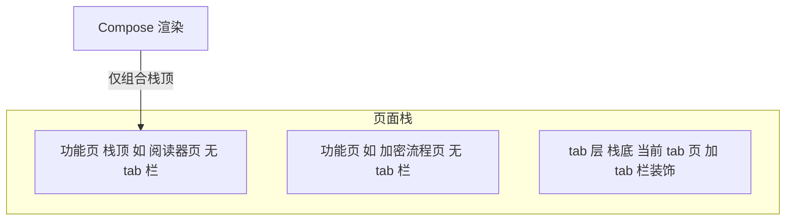
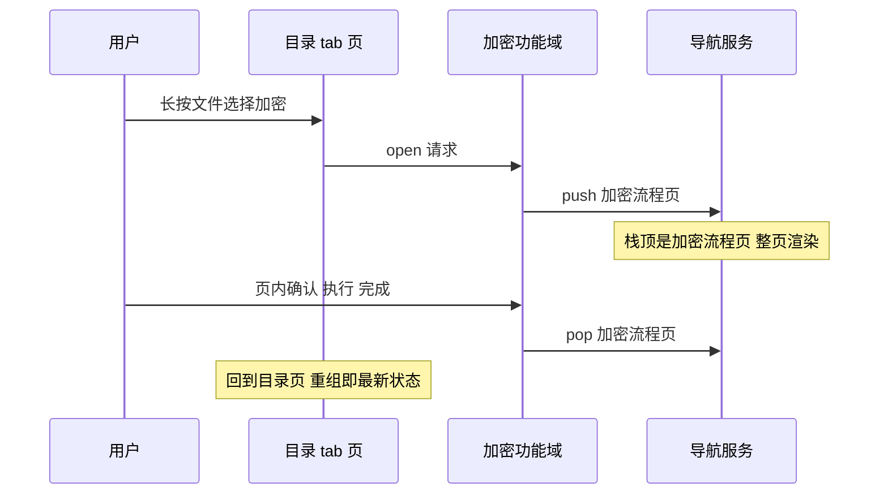

# 主界面判断归位设计

## 1. 设计目的

`PlataleaApp.kt`（1095 行）经 AppShell 分层改造后，tab 接口已经收敛，但其中的 `MainTabsRootContent` 局部函数（370 行）仍然混乱：名为"tab 内容宿主"，实际只有约 40 行属于 tab 切换，其余是 6 个功能对象的创建、8 组对话框的挂载调用、一个 13 分支的 `BackHandler`、退出函数中对 QUICK_NOTE 的点名特判、以及顶层 `activeRoute` 聚合中对各域内部状态的逐一点名检查。这些混乱共享同一个根源：**主界面收容了不属于它的判断**——"crypto 有没有确认框要弹"、"速记退出时要不要确认"、"阅读器的全屏查看器激活了没"，这些问题的答案都不属于"现在屏幕显示什么 tab"。

本文第一版（2026-10-10，见 git 历史）以"判断归位"为公理，方案是把每个判断连同它的显示送回所属功能域：域声明常驻投影（overlay），主界面提供全屏显示记录、退出协商等机制。检讨这个方案，它管理的仍是那棵**共享的 Compose 树**——所有功能的对话框、tab 内容、全屏查看器都组合在同一棵树上，于是必须发明投影挂载、占据记录、返回键协商这一整套机制来分配树上的位置与所有权。接口从十几个降到五组，但没有归零，因为问题本身还在：只要显示是共享的，"谁显示在哪"就需要仲裁。

本版转向一个更根本的建模。Compose 的显示行为本质是"网页"：每次显示一个新界面，是把一个新页面交给它整页渲染，而不是在一棵常驻树上叠开一层窗口。据此，显示的原子单位应该是**页面**——每个功能自己绘制整个页面，同一时刻只有**页面栈的栈顶**一页在组合。tab 栏不再是主界面持有并切换的全局结构，而是 tab 页面套用页面框架的公共装饰；tab 切换是页面自己调用导航函数替换 tab 层；加解密这类"弹出对话框"式的功能是 push 一个不带 tab 栏的功能页，完成后 pop 回上一页。共享树消失了，"谁挂哪"的问题连同它的全部仲裁接口一起消失——**主界面的判断收敛为一个：栈里有什么、栈顶是谁**。

定性：重构，全部既有行为等价。不改命令式协作模型（见《主界面AppShell分层设计》§2）、共享数据对象层、配置投影层；改变的只是显示层的组织方式。设计基线：2026-10 工作区（文件共享功能删除后）。

## 2. 设计逻辑

### 2.1 公理：判断与属地

程序的界面状态由一组**判断**构成——每个判断是运行中持续回答的一个有状态的问题："现在激活哪个 tab？""当前目录显示什么？""加密流程走到确认还是执行？"每个判断有唯一的**属地**：持有其状态、并独占回答权的模块。一个模块读另一个模块的判断结果是正常的依赖，但把别人的判断状态或判断过程搬进自己，就是越界。对着一段代码问"这段在回答谁的问题"，就能机械地判定归属。

主界面（PlataleaApp）的本职判断只有一个：**页面栈——栈里有哪些页、栈顶是谁**。门（解锁、无根目录）是进入 tab 层前的启动页面，也以页面形态入栈。除此之外的判断（流程、进度、目录内容、退出细节）全部住在所属功能域。

### 2.2 页面：显示的原子单位

页面是一个功能的一次完整显示：它自己绘制整个屏幕，包括要不要显示 tab 栏这样的装饰决定。页面是**投影**，不持有业务状态——状态在全局对象（共享数据对象与功能对象，AppShell 分层设计已确立），页面组合时读对象显示，离开组合状态不丢，回来重组即最新。这与网页的类比一致：URL 指向的页面每次整页渲染，数据在服务器（这里是对象）里。

同一时刻只有栈顶一页在组合。这是模型的核心约束，它带来两个直接推论：

- **没有叠加**：不存在"对话框盖在 tab 上、tab 盖在门上"的层叠结构，每刻屏幕上只有一个功能的显示；
- **组合即活动**：栈顶页所在的功能就是唯一活动的功能（单活动原则的自然表达），其余页面连组合都不在，谈不上干扰。

### 2.3 导航：唯一的域间显示接口

页面之间的全部关系收敛为导航服务提供的一组动作：



栈分两层，各自有自己的导航动作：

- **tab 层（栈底）**：`switchTab(tab)` 把当前显示的 tab 页替换为目标 tab 页。tab 页是套用了公共 tab 栏装饰的页面（§2.4）；tab 之间的状态保持不靠页面（页面离开组合），靠各域的状态对象。
- **功能页层（栈底之上）**：`push(page)` 进入一个功能页，`pop(page)` 退出它回到上一页。功能页不带 tab 栏——用户无法从功能页中途切走，只能完成或返回，流程完整性由导航语义天然保住。这正是第一版要用"常驻投影"解决的场景（目录页发起加密后切走、确认框必须还在）：页面模型里该场景不可能发生。

`pop(page)` 带参数且仅当栈顶仍是该页时生效（引用判定），防止功能完成后晚到的清除误弹掉后入栈的页面——与第一版"防误清"同构，但只此一处需要这种防御。

门页面（解锁、无根提示）是启动时的普通页面：通过后导航进 tab 层，无需特殊机制。

一次"目录页发起加密"的完整导航链：



注意域间调用链没有变：目录页调加密域的 `open(request)`（命令式直呼），加密域执行、回写共享数据对象——变的只是加密域的显示方式：从"在主界面的树上挂对话框"变成"push 自己的功能页"。

### 2.4 tab 栏的去中心化

tab 栏从"主界面持有并切换的全局结构"变为**页面框架提供的公共装饰**：一个 tab 层页面模板，内部向导航服务取 tab 列表、渲染 tab 栏（现成的 `ScrollableMainTabBar`）、把点击转成 `switchTab`。每个 tab 域用这个模板包住自己的内容即得到完整页面——域对 tab 机制的全部依赖就是这一个模板，域之间互相不可见。

由此主界面不再渲染 tab 栏、不再组合 tab 内容、不再持有"激活 tab"以外关于 tab 的任何知识。切换是当前页面自己的动作：用户在目录页点 tab 栏的播放器项，是目录页（经模板）调用 `switchTab(PLAYER)`，播放器页进入组合、目录页离开——各自内部收尾，没有全局协调者。

### 2.5 页内自由与公共装饰

页面是自己的地盘：页内的 AlertDialog、进度框、局部返回键处理，都是页面内部的组合，不产生任何跨域接口。要页面化的只是**跨域的功能级弹显**——crypto 流程、压缩向导、快速遮罩、换根、外源保存、公告转发这类由一个域发起、原挂在主界面上的显示。它们的 UI 组件（各域的 Dialogs 文件）不必重写，只需把组合位置从主界面挪进功能页（页内继续用 Dialog 形态，视觉与返回键行为等价）。

公共装饰是多个页面共享的屏幕元素，由页面框架统一提供，页面选用：tab 栏模板（tab 层页面用）、全局保存进度横幅（框架层组合，数据来自外源保存工作流对象）。装饰的判断（如"tab 栏显示哪些项"）在导航服务，装饰的渲染在模板——不进任何功能域，也不需要功能域逐个复制。

### 2.6 与对象模型的关系

页面栈模型不改动既有对象协作，只重排显示层：

- **命令式直呼**照旧：域间发起仍是调用具体对象的窄 API；
- **回写共享数据对象**照旧：操作完成调 `directory.refresh()`、`pendingList.clearAll()`；
- **组合即投影**照旧且更纯粹：每个页面是干净的投影，业务状态零迁就；
- **单活动原则**获得直接表达：栈顶即活动页，无需另行声明。

现状其实已半个身子在此模型中：`transientRoute`（阅读器等全屏页）、`operationRun`（批量执行页）、解锁门、无根提示都是整页显示，`activeRoute` 的顶层分派已是"渲染栈顶"的雏形。本设计是把这个走了一半的模型走完——把另一半（8 组对话框、tab 宿主）也统一为页面与页内组合，删除为两套并存而发明的聚合与挂载机制。

### 概念空间

以上推理引入的概念汇总：

* **判断/属地**（第一版确立，继承）：运行中持续回答的有状态问题，及其唯一持有回答权的模块（§2.1）。
* **页面**：一个功能的一次完整显示，自绘整屏、自选装饰；纯投影，状态在全局对象（§2.2）。
* **页面栈**：主界面的全部判断——栈里有哪些页、栈顶是谁；同一时刻仅栈顶在组合（§2.2）。
* **tab 层与功能页层**：栈的两层；tab 层经 `switchTab` 替换，功能页经 `push/pop` 进出，功能页不带 tab 栏（§2.3）。
* **导航服务**：主界面提供给各域的唯一显示接口（switchTab/push/pop + tab 列表数据）（§2.3）。
* **公共装饰**：页面框架统一提供的共享屏幕元素（tab 栏模板、全局横幅），页面选用（§2.5）。
* **页内组合**：页面内部的对话框、返回键等局部显示，不产生跨域接口（§2.5）。

## 3. 核心数据结构

本设计是重构，域内部数据结构不变；新增的结构只有一个导航服务与页面接口。

**页面**（各域实现，主界面只见接口）：

```kotlin
interface AppPage {
    val content: @Composable () -> Unit   // 整页渲染：自绘屏幕 + 自选装饰
}
```

**导航服务**（组合根创建，即主界面全部的显示状态）：

```kotlin
class NavigationState(tabs: List<TabDescriptor>, initial: MainTab) {
    val currentTab: State<MainTab>                    // tab 层当前显示谁
    val featureStack: SnapshotStateList<AppPage>     // 功能页层（栈底在头）
    fun switchTab(tab: MainTab)                      // 替换 tab 层显示
    fun push(page: AppPage)                           // 进入功能页（成为栈顶）
    fun pop(page: AppPage)                            // 仅当栈顶仍是该页时弹出
    val top: AppPage?                                 // 栈顶功能页；空 = 显示 tab 层
}
```

**页面工厂**（各域提供，替代第一版的 content/overlay 双投影）：

```kotlin
// tab 域：套 tab 栏装饰的页面
fun browserTabPage(deps...): AppPage
// 功能域：无 tab 栏的功能页
fun cryptoFlowPage(workflow: CryptoWorkflowState): AppPage
```

协作总结：组合根创建全部对象与导航服务、接线（把 `Navigator` 交给需要发起跳转的域）；主界面 composable 的全部工作是对 `top` 的一次分派——栈非空组合栈顶页，为空组合 `currentTab` 对应的 tab 页。门是启动时 push 的普通页面。

## 4. 接口定义

**主界面暴露给域的能力**（导航，唯一一组）：

```kotlin
interface Navigator {
    fun switchTab(tab: MainTab)    // 在 tab 层内切换（tab 层页面经模板调用）
    fun push(page: AppPage)        // 进入功能页（功能域发起）
    fun pop(page: AppPage)         // 退出自己 push 的功能页（功能域完成时调用）
    val tabs: List<TabDescriptor>  // tab 列表（tab 栏模板渲染用）
}
```

**域提供给主界面的能力**（页面工厂，每组一函数）：

```kotlin
fun xxxTabPage(deps...): AppPage    // tab 域：套公共 tab 栏模板
fun xxxFeaturePage(...): AppPage    // 功能域：整页自绘
```

**返回键与退出**：页面内部自挂 `BackHandler`（栈顶页的组合位置天然最内层，优先于导航层）；导航层兜底 pop 栈顶功能页；栈只剩 tab 层时返回键交主界面公共策略（双击确认退出、快捷方式直达跳过）——主界面不知道也不需要知道哪个域会拦截返回，拦截发生在域自己的页面里。

判定规则（一个 UI 元素或状态的归属，依次问）：它回答"栈顶是谁/栈里有什么"吗（归导航服务）；它是一次功能的完整显示吗（该域提供页面）；它是页内局部显示吗（页面内部，无跨域接口）；它是多页面共享的装饰吗（归页面框架）；它是有状态的数据吗（归全局对象，页面只投影）。五问无归属的，不建新家，回到引入它的域重新审视。

## 5. 迁移路径

每批行为等价、独立编译提交：

1. **P1 导航服务落地**：新建 `NavigationState` 与 `AppPage`；主界面顶层 `when` 改为对 `top`/`currentTab` 的分派；现状已是整页的四类显示（解锁门、无根提示、批量执行页、transient 阅读器页）映射为初始页面；`MainTabsRootContent` 拆出 tab 层页面。
2. **P2 对话框功能页化**：8 组跨域弹显（crypto/压缩向导/快速遮罩/换根/外源保存覆盖确认/公告转发）改为 push 功能页，Dialog UI 组件留在域文件、组合位置挪进页内，返回键随页；主界面删除全部挂载调用与 13 分支 BackHandler。
3. **P3 tab 栏去中心化**：`ScrollableMainTabBar` 收进 tab 层页面模板，各 tab 域套模板；主界面不再渲染 tab 栏。
4. **P4 出口收敛**：`BrowserTabHostDependencies` 的 22 字段按目标域拆窄 API + `Navigator`；`bulletinForwardPayload` 等主界面中转状态迁入所属域。
5. **P5 主界面定型**：组合根收敛为"创建 + 接线 + 组合栈顶"，目标 200-300 行。

每批真机验证点：返回键次序逐场景对照（页内拦截、功能页 pop、tab 层退出）、功能执行中无法中途切走、tab 切换后状态保持（目录滚动记忆）、门页面通过链路。

## 6. 否决的备选

**共享树上的投影归位**（第一版方案，git 历史保留完整推理）：overlay 常驻投影、全屏显示记录、退出协商五组接口管理树上的位置分配。被否的原因：问题被管理而非消除——只要显示共享，仲裁机制就必要；页面模型取消共享，这组接口整体失去存在理由。

**多 Activity 页面栈**：物理上最接近"网页"（每 Activity 独立 view 树），但违背单 Activity + Compose 基线，且跨 Activity 的状态传递与命令式直呼协作模型冲突（对象引用过不了组件边界）。

**引入官方 Navigation-Compose 库**：其 destination-id 路由语义与"tab 层替换 + 功能页 push/pop"的分层模型不匹配（tab 页保态切换需要额外手段），自管 `SnapshotStateList` 约 50 行即贴身；可作为实现参考，不作依赖。

## 7. 变更历史

| 日期 | 变更原因和内容 |
| --- | --- |
| 2026-10-10 | 初版：主界面收容大量功能域的判断，以"判断归位"为公理划界（共享树上的投影归位方案） |
| 2026-10-11 | 二版：投影方案仍需为共享显示树发明仲裁接口，问题被管理而非消除；转向页面栈模型，主界面判断收敛为页面栈本身 |
