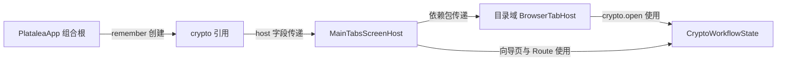
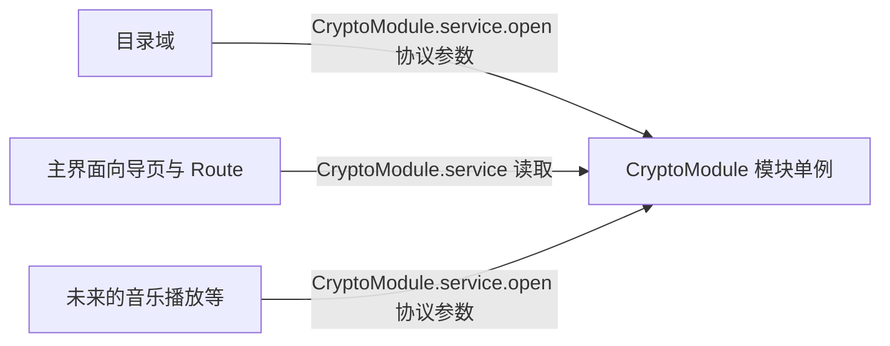
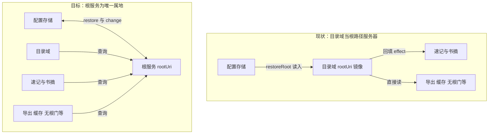

# 功能模块化设计：加密模块与根服务（第一批样板）

## 1. 设计目的

主界面判断归位（P1–P5）与功能独立化（速记/书摘拆域服务与页面）完成后，页面层的显示模型已经就位：每个功能是一个独立页面，页面生存期即功能运行期。但功能的**服务层**仍然全部住在组合根——PlataleaApp 主函数开头的一组 remember 集中创建约十五个域对象，并把它们的引用经 host 快照、依赖包层层传给真正的使用方。这个形态带来三个具体问题：

1. **调用边经过组装点**。目录域调用加密，crypto 引用要从组合根传进 MainTabsScreenHost 字段、再传进 BrowserTabHostDependencies，最后才到达调用行。未来音乐播放要支持加密音乐，就必须再拉一条从组合根到音乐播放的传递链——加密功能和它真正的调用方之间，始终隔着无关的中转站。
2. **可删除性差**。删除一个功能要同时挖开：组合根的创建行、host 的字段、传递链、接线点。使用它的代码和无关的组装代码一起被破坏。
3. **判断属地错位**。"当前根是什么"的真源在配置存储（DataStore），但内存镜像挂在目录域（`BrowserTabState.rootUri`），速记与书摘靠 `LaunchedEffect(browserTab.rootUri)` 回填订阅目录域的属性。目录域成为根路径的"服务器"是历史偶然——它只是第一个使用根的功能。按判断归位设计确立的属地公理，"当前根"的属地是根功能本身：任何域（目录、速记、配置导出、查看器缓存）获取根路径的方式应当完全对称。

本设计确立目标模型为：**每个功能是一个独立模块，模块对外提供可调用的服务；模块之间只通过约定的参数互相调用，调用边在使用点声明；功能服务进程级存活，不随页面销毁或 Activity 重建而重建**。加密功能的未来调用方（音乐播放等）直接调用加密模块，用约定的参数传入目标文件；没有人再需要加密时，删除模块即可，编译器报错的正是仍在使用它的调用点，而非无关的组装代码。

这是全量重构，涉及约十五个域。本批只做两个样板验证模型与纪律，其余域待样板确认后铺开：

* **加密模块**：无界面向导型功能的代表——无独立 tab、由其他域发起、参数天然是协议数据（文件 uri + 目录 uri）。做它验证"多调用方 + 拉进来就用"。
* **根服务**：共享会话参数的代表——rootUri 从目录域归位到根功能。做它验证"判断集中 + 各域对称获取"。

不做的：其余十三个域的迁移（待样板确认）；不引入依赖注入框架（模块 object + 惰性单例已覆盖需求，不为此增加框架复杂度）。

设计基线：P5 + 功能独立化完成的工作区（未提交，基于 5157e11）。

## 2. 设计逻辑

### 2.1 模块模型与四条纪律

先定义本设计的核心概念。**模块**：一个功能的全部分工单元，含服务（数据+行为，进程级存活）与页面构造（需要显示时提供）。模块以 Kotlin `object` 呈现，内部惰性创建并持有服务实例——首个调用者触发构造，此后进程内复用。**协议参数**：模块间调用时传递的、被调用方独立可解释的数据（uri 字符串、路径、文件模型、回调），调用方不得把自己的内部状态对象当作参数传给被调用方。

模块模型要成为可维护的形态而非分布式混乱，必须同时立住四条纪律。这些纪律不是本设计新发明的前置条件，而是从"模块为什么能被任何调用方使用"直接推出的：调用方传来的数据被调用方必须能独立解释，否则模块间就不是协议耦合而是结构耦合；显示如果不走统一的导航服务，每个模块就得自己发明弹页面机制；进程级存活的服务如果自造协程作用域，就没有人能可靠地取消它。

此外一条根的适用规则（用户拍板）：**换根对所有功能立即生效**。修改根必然发生在文件浏览功能上，它会立即更新根服务；此后其他功能在下一次被显示或被调用时读取最新值即可。后台持续运行的服务（如音乐播放）不依赖根，直接使用绝对 uri（现状即如此，点播时不查根）。

1. **协议数据边界**：模块间参数只用协议数据（uri、路径、字符串、文件模型、回调）；禁止传递调用方的内部状态对象。守住它，"加密可以从任何地方发起"才成立。
2. **显示走导航服务**：模块提供自己的页面构造函数；"要显示"这件事调用导航服务（向导页入栈、全屏 Route），模块不自建弹窗通道。
3. **进程级存活，不自持作用域**：服务实例随进程存活；模块不自行创建 CoroutineScope——需要异步的入口由调用方发起（调用方的 scope 执行），或由模块入口显式接受 scope 参数。这样取消权始终在带生命周期的调用方手里。
4. **测试走工厂**：服务的核心状态类保持普通类（现状已如此，如 CryptoWorkflowState），模块 object 只是生产路径的惰性单例壳；测试直接构造实例，不经全局单例。模块提供 reset 钩子（仅测试用）。

以加密为例，现状与目标的依赖形态对比如下。现状（调用边经组装点）：



目标（调用边回到使用点）：



两图的差别不在对象数量，在**边的位置**：组合根从"创建者+中转站"退为纯粹的启动者（见 §2.4），加密模块的每条入边都在实际调用处声明。

### 2.2 样板 A：加密模块

加密域现状：`CryptoWorkflowState` 是纯状态类（单槽向导：request、password、passContent、passEdit 等，行为自洽、可直接测试）；创建于 PlataleaApp（rememberCryptoWorkflow）；目录域经依赖包持有引用，7 处 `crypto.open(CryptoRequest...)` 发起（GPG 单文件/批量加解密、pass 保护/查看/编辑）；显示侧由主界面接管——向导页经 DialogPageBinder，pass 查看器/编辑器聚合进 activeRoute（TransientRoute.PassViewer/PassEditor）。它的参数（DocumentFileModel、dirUri 字符串）已是协议数据，满足纪律 1，因此是样板首选。

模块化改造：

* 新增 `CryptoModule`（object），惰性持有 `CryptoWorkflowState` 实例，对外暴露 `service` 属性；`CryptoWorkflowState` 本身不动。
* **发起侧**：BrowserTabHost 的 7 处调用改为 `CryptoModule.service.open(...)`；依赖包与 host 快照中的 crypto 传递链删除。
* **显示侧**：主界面向导页工厂、activeRoute 聚合、PassViewer/PassEditor 渲染、顶部进度条全部改为读 `CryptoModule.service`。`TransientRoute.PassViewer/PassEditor` 不再携带状态引用（模块状态唯一，Route 携带反而制造第二份真源）；Route 分派次序不变。向导页的判断与动作分工："是否有向导在跑"由加密模块的状态回答（request 非空）；"显示"由导航服务执行——观察到 request 非空即入栈向导页（密码框/选公钥/确认），完成或取消后 request 清空、出栈退回发起页。调用方只发起 open，不参与向导的显示与退出。
* **退出侧**：向导的取消/完成仍由状态类的 close()/结果转移方法完成（现状逻辑不动）。

行为差异评估：现状 Activity 重建时向导状态随组合销毁而清空（用户填到一半的密码丢失）；模块化后随进程存活，重建后向导仍在。这是改善而非回归，与"功能不是临时创建、完成后释放"的定位一致。

### 2.3 样板 B：根服务

rootUri 现状链路：配置存储（DataStore `config.rootUri`）是持久真源；启动时 `browserTab.restoreRoot()` 读入内存镜像挂到目录域；换根向导 `applyNewRoot` 写存储 + `browserTab.changeRoot`；速记/书摘经回填 effect 订阅目录域镜像；查看器会话缓存、配置导出、无根门、待处理列表等十余处直接读 `browserTab.rootUri`。

归位改造：

* 新增 `RootService`（object，根功能的服务）：持有 `rootUri`（Compose 状态，进程级）、`restore`（从配置存储读入，幂等：已有值不覆盖）、`change`（写内存 + 持久化存储）。模块不自持 scope：`change` 与 `restore` 为挂起函数，由调用方（换根向导、启动流程）在自己的作用域执行。
* **目录域退位为查询方**：`BrowserTabState.rootUri` 改为转发属性（`get() = RootService.rootUri`），`restoreRoot`/`changeRoot` 删除；目录会话对根变化的响应（currentUri 重置、后退栈清空）保留在换根向导的编排里——编排不变，只是其中"改根"一步改为调 `RootService.change`。
* **回填 effect 删除，改为显示时核对**：速记/书摘服务的 rootUri 字段删除；服务记录会话打开时的根（sessionRoot）。页面进入组合时核对 sessionRoot 与 RootService.rootUri：不一致说明换过根——先对旧会话做一次收尾保存（写入旧根，修改不丢；速记已由页面退出协议完成，书摘在此补做，hash 守卫无变化时零开销），再清空会话并按新根重新加载。换根因此对所有功能立即生效。
* **对称查询**：查看器会话缓存（根变化即清空，维持现状）、配置导出（每次导出实时读取）、无根门、待处理列表等全部读点改为 `RootService.rootUri`，删除经 browserTab 的中转。

属地变化：



行为差异评估：现状每次 Activity 重建都重新 restoreRoot；归位后进程内只恢复一次，后续重建直接复用内存值。两次读取的都是同一存储值，语义等价；进程级缓存反而消除了重建窗口内存储被外部改动的竞态。另一处行为变化：现状换根后已打开的速记/书摘会话继续指向旧根文件直至下次手动重开；新设计换根即失效，下次显示时旧会话收尾保存后按新根重载（见回填 effect 条目）。

### 2.4 组合根的剩余职责

模块化后组合根（PlataleaApp 主函数）还剩什么？三件事，且都不再持有域服务引用：

1. **启动**：调 `RootService.restore`、恢复导航状态（当前 tab、初始目录）——即"根功能检查自己的参数，没有就走向导补齐"。
2. **组合栈顶**：顶层 when 分派（门、向导页、全屏 Route、tab 层）——导航服务的实现处，认识页面类型（协议），经各模块的页面工厂渲染，不认识模块内部状态。
3. **跨域接线的残余**：少量"调用 A 的出口直呼 B 的服务"的接线（如公告转发）保留为直呼——调用边已在接线处声明，符合模型。

组合根开头那组"十五个域的 remember 创建列表"随之消解为少数根级状态（导航、启动恢复）。

## 3. 核心数据结构

```kotlin
/** 加密模块：惰性单例壳，服务实例进程级。核心状态类不变。 */
internal object CryptoModule {
    private var instance: CryptoWorkflowState? = null
    val service: CryptoWorkflowState
        get() = instance ?: CryptoWorkflowState().also { instance = it }

    /** 仅测试用：重置单例。 */
    fun resetForTest() { instance = null }
}

/** 根服务：根功能持有的会话参数，进程级。不自持作用域。 */
internal object RootService {
    var rootUri by mutableStateOf<String?>(null)
        private set

    /** 从配置存储恢复（幂等：已有值不覆盖）。 */
    suspend fun restore(config: ConfigService) { ... }

    /** 换根：写内存态并持久化。 */
    suspend fun change(uri: String, config: ConfigService) { ... }

    fun resetForTest() { rootUri = null }
}
```

## 4. 主要修改点

| 文件 | 修改 |
| -- | -- |
| ui/CryptoModule.kt（新） | 模块壳；向导页工厂+显示条件（CryptoWizardBinding）内聚于此——加密模块完整样板 |
| ui/RootService.kt（新） | 根服务 |
| ui/BrowserTabHost.kt | 7 处 open 直呼模块；rootUri 转发；restoreRoot/changeRoot 删除 |
| ui/BrowserDialogs.kt | applyNewRoot 编排中"改根"改调 RootService.change |
| ui/PlataleaApp.kt | 删 crypto 创建与传递、删回填 effect、启动调 RootService.restore、activeRoute 聚合只问 CryptoModule.activePassRoute（pass 显示判断内聚模块）；向导接线收敛为 CryptoWizardBinding 一行 |
| ui/AppDialogPages.kt | cryptoDialogPage 工厂迁出（归位加密模块文件）；DialogPageBackHandler 改 internal 供域内复用 |
| ui/QuickObfuscateDialogs.kt | QuickObfuscateModule + QuickObfuscateWizardBinding（遮罩，第二批） |
| ui/ArchiveOperationWorkflow.kt | ArchiveOpsModule + ArchiveOpsWizardBinding（压缩/解压，第二批） |
| ui/BrowserDialogs.kt | RootSwitchModule + RootSwitchWizardBinding、BrowserSaveModule + BrowserSaveWizardBinding（第二批） |
| ui/BulletinForwardTargetFlow.kt | BulletinForwardBinding（公告转发页绑定归 family 域，第二批） |
| ui/ArchiveReaderWorkflow.kt / EpubReaderWorkflow.kt | ArchiveReaderModule / EpubReaderModule（查看器，第二批） |
| ui/ReadingLauncher.kt | 构造依赖删，分流表直呼两查看器模块 |
| ui/NavigationState.kt | DialogPageBackHandler 归位（与 DialogPageBinder 同属导航机制）；AppDialogPages.kt 删除 |
| ui/MainTabsScreen.kt | host 删 crypto/rootUri 传递；读点改查询 |
| ui/QuickNoteService.kt / BookNoteService.kt | rootUri 字段删除；会话记录打开时的根，页面进入时核对，不一致则旧会话收尾保存后按新根重载（换根立即生效） |
| ui/TransientRouteHost.kt 等 | PassViewer/PassEditor 渲染读模块；rootUri 读点改查询 |
| ui/ConfigImportExportWorkflow.kt | rootUriProvider 改为 RootService 查询 |

## 5. 概念空间

* **模块**：一个功能的全部分工单元（服务 + 页面构造 + 入栈绑定），以 object 呈现，服务惰性单例、进程级存活（§2.1）。模块文件内聚页面工厂与显示条件（如 CryptoWizardBinding），组合根只保留一行绑定调用——新增功能 = 新增一个模块文件 + 组合根一行，不改既有工厂文件。
* **协议参数**：模块间调用传递的、被调用方独立可解释的数据；调用方内部状态对象不属于协议参数（§2.1）。
* **根服务**：根功能（PlataleaApp 级）持有的会话参数服务，本批即 rootUri 的唯一属地（§2.3）。
* **调用边在使用点声明**：模块间的依赖关系由调用处的静态调用表达，不经第三方组装点中转（§2.1）。

## 6. 一致性校验

* **接口完备性**：加密发起（open 族）、向导页显示与出栈条件（CryptoWizardBinding 模块内聚）、pass 查看/编辑显示（activePassRoute 判断内聚于模块，组合根只聚合）、进度投影（pubEncryptInProgress）各有落点；根的恢复、变更、查询均有接口。无丢口。
* **层次一致性**：换根的**编排**（记最近根、清后退栈、重置目录会话、初始目录回写）仍属换根向导（目录域向导），RootService 只承担"根是什么"的判断与持久化——编排逻辑没有下沉到服务，服务也没有上浮成向导。
* **生命周期一致性**：两个样板均不自持 scope（crypto 无协程；RootService 挂起函数由调用方执行），进程级存活无泄漏口；速记/书摘已有的组合根 scope 用法（保存协程）不在本批范围，维持现状。
* **测试一致性**：CryptoWorkflowState、RootService 状态读写均可脱离单例直接构造或 reset 后测试；现有单测不受影响。

## 变更历史

| -- | -- |
| -- | -- |
| 2026-10-15 | 初版：确立模块模型与四条纪律，两个样板（加密模块、根服务）设计 |
| 2026-10-15 | 按拍板结论修订：换根对所有功能立即生效（显示时核对+收尾保存后重载），后台服务不依赖根；澄清向导页判断在模块、显示在导航 |
| 2026-10-16 | 向导页工厂从 AppDialogPages（主界面文件）归位加密模块文件（CryptoWizardBinding：工厂+显示条件一体）；pass 全屏 Route 的显示判断同步收进模块（activePassRoute），组合根聚合处不再认识 request 类型分支——至此加密模块为完整样板：发起在使用点、判断在模块、显示在导航 |
| 2026-10-16 | 第二批推广：遮罩/压缩解压/换根/另存为/公告转发/归档查看器/EPUB 阅读器七个域按样板模块化（attach 一行接线 + 调用点直呼 + 工厂与显示条件归域文件）；AppDialogPages.kt 撤销，DialogPageBackHandler 归 NavigationState.kt；MainTabsScreenHost 与浏览器依赖包的六条跨域传递链删除 |
