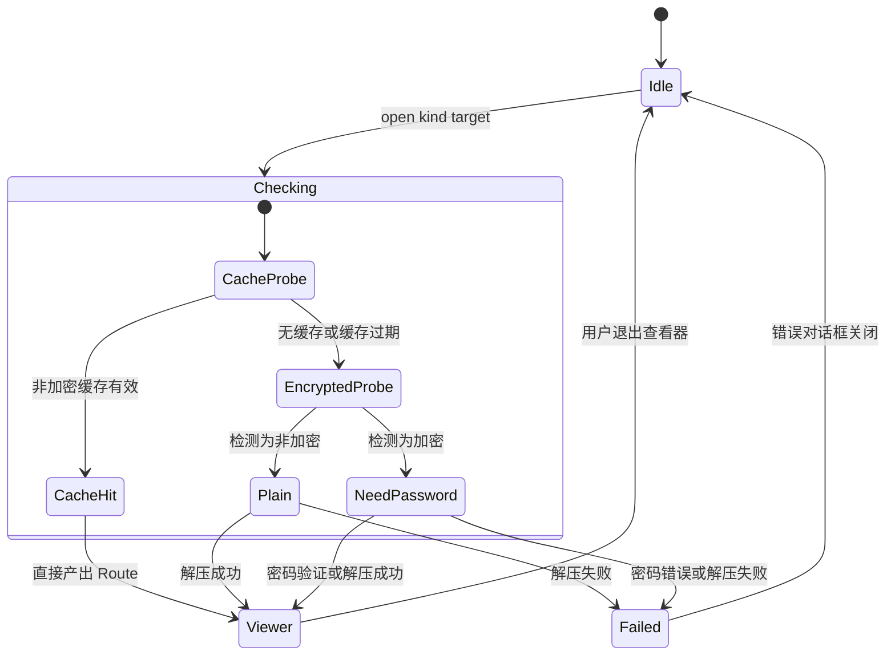
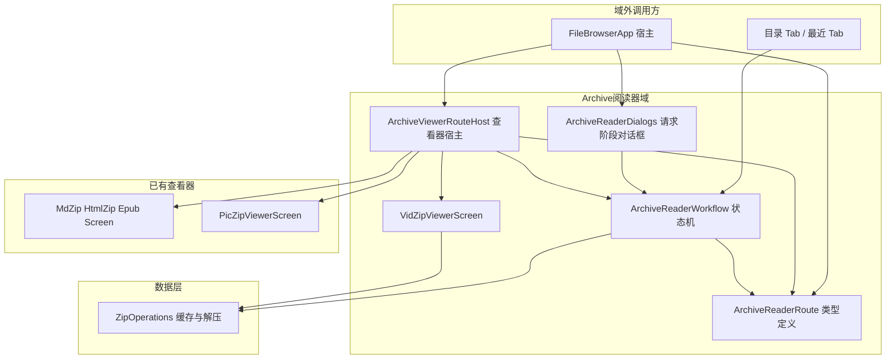

# 打包文件阅读器（Archive Reader）设计文档

## 1. 设计目的

文件浏览和最近打开列表里有一类文件：`.md.zip`、`.html.zip`、`.llm.zip`、`.epub`、`.txt`、`.llm`、`.pic.zip`、`.vid.zip`。它们共同的特点是：**本身不是内容，而是内容的打包容器**——用户点开它时，程序要先把它解开（可能要先解密），才能把里面的东西显示出来。本文把这类文件称为**打包类型文件**。

本域要回答的使用场景只有一个：**其他 Tab 的某个功能（目录列表、最近打开）说"我要看这个打包类型文件"，之后发生的一切由谁负责、分成几步、在哪里结束。**

在分层改造之前，这个场景没有归属者。8 种文件各自的打开状态（目标文件、加密标志、密码、进度、日志、加载错误）以约 34 个散装变量的形式平铺在主程序 FileBrowserApp 里，每种文件还各带一段检查副作作用、一组对话框、一个全屏查看器分支。这带来两个直接的问题：第一，主程序必须理解每种打包文件的解压细节，任何一种新增或修改都要在主程序里同时动六处；第二，"同一时刻只能打开一个"这个事实只存在于约定中，由主程序自己小心维护，没有任何结构上的保证。

Phase 3 批次 A 的改造（本文的设计基线：master 分支 e91e5cc 之后的未提交改动）把这组能力整体迁出主程序，收敛为 5 个文件、约 1650 行的独立域。本文是对这个域的**逻辑视图建模**：设计已经落地，这里的目的是把"为什么这样切"的推理过程说清楚，使后续批次（压缩向导、Crypto、PendingList）可以按同样的思路推进，也使新增一种打包类型时有章可循。

边界说明：zip 的**压缩**向导（打包生成 .zip）、gpg/pass 等加密文件操作、以及不经解压直接打开的单文件查看器（Markdown/HTML/PDF 等，属于 TransientRoute 域）不在本域范围内。本域只管"打开一个打包类型文件并阅读"这一件事。

## 2. 设计逻辑

### 2.1 分解线：为什么是"两阶段"

设计的第一步是找到 8 种文件的共性和差异到底在哪。观察用户点开一个打包类型文件之后发生的事，可以切成时间上先后两段：

**第一段（打开之前）**：查有没有可用缓存 → 检测是否加密 → 加密则要密码 → 解压（或转换）成一组可渲染的内容。这一段对 8 种文件**几乎同构**：差异只体现在调用哪个解压函数、日志粗细、进度是否可见，流程骨架完全一致。

**第二段（打开之后）**：把解出来的内容显示出来。这一段对 8 种文件**完全不同**：markdown 是长文滚动阅读，html.zip 是网页渲染，epub 是章节翻页书，pic.zip 是图片画廊，视频是列表加外部播放器。它们本来就已经是 5 个互不相干的全屏 Screen 组件。

"解压完成"这个时刻就是天然的分解线。线之前的过程抽象为一个**工作流**（一个对象、一个状态机），线之后的产物抽象为一个**查看器状态**（一个 sealed 类型、五个子类）。这一刀切下去，主程序对打包文件的全部认知就缩减为一句话：发起请求，等一个查看器状态出现。

### 2.2 概念空间

先给出本域的核心概念，后面所有视图都建立在这组概念上：

* **打包类型文件（archive file）**：以 zip 为容器、按扩展名约定内容类型的文件，共 8 种。`.epub` 本身就是 zip 容器；`.txt` 和 `.llm` 不解压，但要**转换**成 EPUB 结构，转换产物与解压产物同构，因此也纳入同一工作流。
* **阅读请求（request）**：某个 Tab 通过 `open(kind, target)` 发起的"我要看这个文件"的意图。请求携带种类与目标文件，是工作流的输入。
* **种类（Kind）**：8 值枚举 `ArchiveReaderKind`，对应 8 种扩展名。它回答"怎么解开"。
* **查看器状态（viewer state）**：解压/转换完成后产出的 `ArchiveViewerState`，共 5 个子类。它回答"用什么 UI 显示"——是查看器的输入快照（各子类名 *ViewState 即此意），不参与导航决策：宿主的顶层 when 只看 `viewer != null` 这个事实，从不区分它是哪个子类。真正的 Route 是导航层的概念（TransientRoute 及宿主的查看器槽位），`ArchiveViewerRouteHost` 之名指它消费这个槽位，而不是说子类是路由。
* **缓存（cache）**：解压产物所在的目录。见 2.5 节。
* **单槽（single slot）**：本域的并发约束——同一时刻至多存在一个阅读请求或一个查看器状态。它不是新加的限制，而是原实现"8 组状态天然互斥"这一事实的显式化，交给状态持有者的类型结构来表达。

这里要专门解释一个容易困惑的点：**为什么是 8 种 Kind 却只有 5 种查看器状态？** 因为 `.llm.zip`（LLM 对话打包）、`.txt`、`.llm` 三种的显示形态都是 EPUB 章节书——它们的解压/转换产物都是 EPUB 结构。也就是说"怎么解开"和"怎么显示"不是一一对应的，这是两个正交的概念层，不能用单一的一组"每种文件一个类"来同时表达两层。Kind 属于请求阶段，查看器状态属于查看器阶段，各自枚举。

### 2.3 请求阶段：一个状态机

请求阶段回答的问题是：从 `open()` 被调用到查看器出现（或失败退出）之间，系统处于什么状态、谁来推进。答案是 `ArchiveReaderWorkflowState` 一个对象，持有以下状态字段：

| 字段 | 含义 |
| --- | --- |
| `request` | 当前请求（null 表示无请求） |
| `encrypted` | 加密检测结果：null=检测中，true/false=结果 |
| `password` / `inProgress` | 密码输入、解压进行中 |
| `log` / `loadError` | 日志（html.zip/epub 用）、解析失败信息 |
| `viewer` | 产出：查看器状态（非 null 即进入第二阶段） |

单槽由结构直接表达：所有字段只有一份，`open()` 一个新请求必然覆盖旧状态。状态机的迁移如下（以"打开"为入口的完整生命周期）：



有几个迁移细节是各 Kind 特有的，状态机骨架不变、由分派函数逐 Kind 实现：

* **缓存命中直接产出**：所有 Kind 都先查缓存，命中则跳过解压直达 Viewer。
* **加密与密码**：只有 md/html/llm.zip/epub/pic/vid 六种有加密形态；txt/llm 转换不存在密码分支。
* **失败的去向不同**：md/pic/vid 失败弹 Toast 即回 Idle；html/epub 失败停在日志状态等用户关闭；txt/llm 失败弹独立错误对话框。这些差异全部留在各自 Kind 的分派函数里，不改变状态机骨架。
* **EPUB 的一个特殊路径**：密码解压失败后 request 保留（密码框还在），用户此时取消（request 清空），loadError 会残留——于是出现一个"无请求但带错误"的过渡态，由独立错误对话框承接。`lastKind` 字段记录最近一次请求的种类，供这个对话框判断错误归属（因为单槽下 request 为空时已经不知道谁失败了）。

状态机的推进者是 `open()`（宿主发起）和 `submitPassword()`（密码框确认），二者内部按 Kind 分派到 8+6 个私有函数。这些函数是原 FileBrowserApp 里 8 段 LaunchedEffect 的逐行平移，行为 1:1。

### 2.4 查看器阶段：分派与善后

查看器阶段回答的问题是：Route 产出之后谁渲染、退出时谁收拾缓存。答案是 `ArchiveViewerRouteHost`，做三件事：

1. **分派**：`when (viewer)` 按 Route 子类调用对应的 Screen——MdZip/HtmlZip/Epub 三个 Screen 在 MarkdownViewerScreen.kt，PicZip 在 PicZipViewerScreen.kt，VidZip 在 VidZipViewerScreen.kt。宿主不含任何一种内容的渲染细节。
2. **最近打开记录**：进入查看器时按 Route 记录（md/html/pic/vid 记为 zip_viewer，epub 系记为 epub_renderer；画廊直入时不记）。这是宿主统一处理而不是各 Screen 自己记，因为"记录"属于域的公共善后。
3. **加密退出善后**：这是所有加密类型的**标准行为**——退出任何加密查看器（md/html/epub/pic/vid 五种一致）都弹确认：删除缓存退出，或保留缓存退出（保留后下次打开仍需密码，但可复用缓存与阅读进度，不重新解压）。确认对话框的状态（`EncryptedCacheExitDialogState`）由宿主经 `onEncryptedExitRequest` 回调**上抛给域外**渲染——因为全屏查看器激活期间，域外的主 UI 层不参与组合，对话框必须渲染在更外层。这是一个刻意的例外：域不渲染自己的确认框，换取"查看器宿主不被对话框逻辑污染"。例外只有一个：目录图片画廊直入是生成物而非解压缓存，非加密，退出即删，不询问。

VidZip 值得一提：它不整体解压视频，而是先解出**视频清单**（video_list），进入查看器后用户点哪个再按需解压哪个条目。所以它的"解压完成"其实只是"清单就绪"——这正是"解压"概念覆盖"转换"（txt/llm）之后，对"按需展开"的第三次泛化：工作流保证的是"可渲染内容已就位"，不要求全部内容落盘。

### 2.5 缓存管理

缓存回答的问题是：解压很贵，第二次打开同一个文件要不要重来、什么时候清掉。这是请求阶段内部最重要的横切策略。

**布局**：每种 Kind 一个缓存目录（按源文件 URI 派生路径），统一的结构约定：

```
<cacheDir>/
  content/        解压出的实际内容（epub 系为 EPUB 结构目录树）
  .cache_ts       缓存时间戳（源文件 lastModified 的快照）
  .image_list     仅 pic.zip：图片相对路径清单
  .video_list     仅 vid.zip：视频相对路径清单
  .last_index     仅 pic.zip：上次阅读位置
```

**复用规则**（两条路径，条件严格递进）：

* 打开时的**非加密复用**：`缓存存在 && 缓存未加密 && ts >= 源文件 mtime && content 非空`。任何一条不满足就删缓存重来。
* 输密码后的**加密复用**：`缓存存在 && 缓存已加密 && ts >= mtime && content 非空 && tryPassword 通过`。密码正确即可复用，避免重复解压大文件。

**生命周期**：创建（首次解压）→ 复用（再次打开）→ 删除。删除有三个触发点，各 Kind 的策略不同：

| 场景 | 行为 |
| --- | --- |
| 缓存过期/为空 | 静默删除重建（所有 Kind 一致） |
| 非加密查看器退出 | 静默保留（下次直接复用） |
| 加密查看器退出 | 弹确认：保留 或 删除（md/html/epub 调 cleanXxxCache；vid 删自己的 cleanupCacheDir） |

pic.zip 是特例：非加密退出也直接删（它是"画廊直入"的主要来源，缓存的一次性语义更强），只有"保存当前图片"路径例外。

缓存管理页（配置 Tab）把五种解压缓存根目录（md_zip_cache、html_zip_cache、epub_cache、pic_zip_cache、vid_zip_cache）统一归类为"浏览缓存"，按 `.encrypted` 标记进一步分为非加密与加密两类，用户可在那里独立删除，不依赖查看器退出时的确认。画廊的临时生成目录（pic_dir_gallery）不属于解压缓存，归入"其他缓存"。缓存的具体读写函数（get/is/clean/extract/try 系列）全部在 data 层 `file/ZipOperations.kt`，本域只编排不实现。这是"解压解密"与"Cache 管理"的第二次分层：**工作流决定何时用缓存策略，ZipOperations 决定怎么读写缓存**。

### 2.6 分层总览与文件组织

把以上推理落到文件上，得到如下的依赖结构（箭头方向为"依赖"）：



注意两条注入线：宿主向 RouteHost 注入会话级依赖（markdown 阅读位置缓存、书签控制器、最近打开记录、保存图片）；RouteHost 向宿主上抛加密退出确认。除此之外域是自闭的——**Tab 不需要知道有几种 Kind，宿主不需要知道解压细节**。

与文件的一一对应：

| 文件 | 角色 | 对应章节 |
| --- | --- | --- |
| ArchiveReaderRoute.kt | 纯数据类型：Kind、Request、5 个查看器状态、退出对话框状态 | 2.2 |
| ArchiveReaderWorkflow.kt | 状态机：open/submitPassword 分派、8+6 组逻辑 | 2.3、2.5 |
| ArchiveReaderDialogs.kt | 请求阶段 UI：密码/进度/日志/错误对话框（无状态，读写 Workflow） | 2.3 |
| ArchiveViewerRouteHost.kt | 查看器宿主：分派、最近打开、加密退出善后 | 2.4 |
| VidZipViewerScreen.kt | vid.zip 列表 UI（按需解压条目） | 2.4 |

一个此前讨论过并明确否决的备选方案在此记录取舍理由：把 8 种 Kind 做成 8 个子类（父类带虚方法 open/submit）会让"8 组几乎同构的逻辑"散到 8 个文件里，共性不可见；而 Compose 的 Screen 本就是顶层函数不依附类，分派 when 无法消除只会挪进虚表。两阶段的分解线（2.1）已经把真正异构的部分（5 个 Screen）隔离在各自的文件里，Kind 的同构逻辑集中反而便于整体对照审查。

### 2.4 节与本节的图表共同回答了开篇的场景

现在把第 1 节的场景完整走一遍，作为逻辑链的收束：**目录 Tab 里用户点了一个 `.md.zip`** → Tab 调 `archiveReader.open(MD_ZIP, file)`（Tab 的全部工作到此结束）→ 工作流查缓存：命中则直接产出 Route，否则检测加密——非加密静默解压，加密弹密码框（域内 Dialogs 渲染，用户无感于哪个 Tab 发起的）→ Route 产出，宿主切走主 UI，分派到 MdZipViewerScreen 全屏渲染 → 用户退出：非加密直接关（缓存保留待复用），加密则上抛确认框问删不删缓存 → 回到 Idle，Tab 的界面原样恢复。**整个过程 Tab 只付出一次 open 调用。**

## 3. 核心数据结构

本域是重构而非新写，数据结构已在代码中定稿，这里只列与设计逻辑对应的关键形态。

**请求与 Route**（ArchiveReaderRoute.kt）：

```kotlin
internal enum class ArchiveReaderKind { MD_ZIP, HTML_ZIP, LLM_ZIP, EPUB, TXT, LLM, PIC_ZIP, VID_ZIP }

internal data class ArchiveReaderRequest(val kind: ArchiveReaderKind, val target: DocumentFileModel)

internal sealed interface ArchiveViewerRoute {
    val recordRecent: Boolean get() = true   // 画廊直入时为 false
}
// 五个子类：MdZipViewState / HtmlZipViewState / EpubViewState / PicZipViewState / VidZipViewState
// 共同字段：内容目录或内容对象、源文件名、源 URI、isEncrypted
// pic/vid 特有：password（后续按需解压还要用）、initialIndex、cleanupCacheDir
```

**状态机**（ArchiveReaderWorkflow.kt）：

```kotlin
@Stable
internal class ArchiveReaderWorkflowState(context, scope) {
    var request: ArchiveReaderRequest?      // 阶段一的存在性标志
    var viewer: ArchiveViewerRoute?         // 阶段二的存在性标志
    var encrypted: Boolean?                 // null=检测中
    var password: String                    // 密码框双向绑定
    var inProgress: Boolean                 // 解压中（禁止取消）
    var log: String                         // html/epub 日志
    var loadError: String?                  // 解析失败
    var lastKind: ArchiveReaderKind?        // request 清空后的错误归属
}
```

**缓存目录布局**见 2.5 节（content/、.cache_ts、清单文件），由 ZipOperations 读写，本域不定义结构。

## 4. 接口定义

本域是重构，对外接口即现有 5 组调用，按使用者分组列出，最后用一个流程把它们串起来。

**调用方（Tab）接口**——发起阅读的全部入口：

```kotlin
/** 从某个 Tab 发起阅读请求。kind 决定解压与显示策略，target 为源文件。 */
fun open(kind: ArchiveReaderKind, target: DocumentFileModel)

/** 宿主直入查看器，绕过请求阶段（目录图片画廊以 PicZip 形态渲染时使用）。 */
fun openViewer(route: ArchiveViewerRoute)
```

**对话框驱动接口**——ArchiveReaderDialogs 内部读写 WorkflowState：

```kotlin
fun updatePassword(value: String)     // 密码输入（解压中冻结）
fun submitPassword()                  // 密码确认，按 kind 分派验证/解压
fun cancelRequest()                   // 密码框取消（解压中不允许）
fun dismissRequestError()             // 错误对话框关闭，同时清请求与日志
fun dismissErrorOnly()                // 独立错误对话框关闭（请求已空）
```

**查看器善后接口**——RouteHost 与宿主之间：

```kotlin
fun closeViewer()                     // 查看器关闭，viewer 置空
// 宿主注入：markdownViewerSessionCache / bookNoteController / recordRecentOpen / onSavePicZipImage
// 上抛回调：onEncryptedExitRequest(EncryptedCacheExitDialogState)——加密退出确认由域外渲染
```

**组合接口**——宿主在组合树中的三处接线：

```kotlin
val archiveReader = rememberArchiveReaderWorkflow(context, scope)   // 创建（域外仅此一次持有）
ArchiveReaderDialogs(archiveReader)                                  // 请求阶段对话框（平级于主 UI）
archiveReader.viewer != null -> ArchiveViewerRouteHost(...)          // 顶层 when 的查看器分支
```

接口之间的关系用完整流程收束：**要打开一个打包类型文件，Tab 只调 `open(kind, target)`；域内先尝试缓存复用，需要密码时由 `updatePassword`/`submitPassword`/`cancelRequest` 完成交互；成功后 `viewer` 非 null，宿主的 `ArchiveViewerRouteHost` 分派渲染；用户退出时非加密直接 `closeViewer`（缓存保留），加密经 `onEncryptedExitRequest` 上抛确认后关闭；失败路径由 `dismissRequestError`/`dismissErrorOnly` 收尾回 Idle。**

主要修改点（相对改造前）：原 34 个散装状态、8 段 LaunchedEffect、8 组对话框、5 个顶层 when 分支删除，入口收敛为上列接口；`ReliablePasswordInputField`、`launchExternalOpen` 两个通用函数从 private 改 internal 供本域复用。行为修复两处：加密退出确认对话框原来渲染在主 UI 层内部，全屏查看器激活时不参与组合导致永不显示，现随查看器宿主上抛到顶层渲染；加密 pic.zip 的退出确认原来在 PicZipViewerScreen 内部自持第二套实现，现并入宿主标准路径，五种加密类型行为一致。

## 5. 变更历史

| 日期 | 变更原因和内容 |
| --- | --- |
| 2026-09-11 | 初版：随 Phase 3 批次 A 落地建立逻辑视图（两阶段工作流 + 单槽状态机 + 缓存策略），基线为 e91e5cc 后的 5 文件拆分 |
| 2026-09-12 | 概念修正：查看器阶段的产物由"查看器 Route"更名为"查看器状态"（ArchiveViewerState），Route 一词收回给导航层；加密退出确认为所有加密类型的标准行为（pic 并入宿主路径，删除 Screen 内部第二套实现）；vid_zip_cache 纳入缓存管理归类 |
