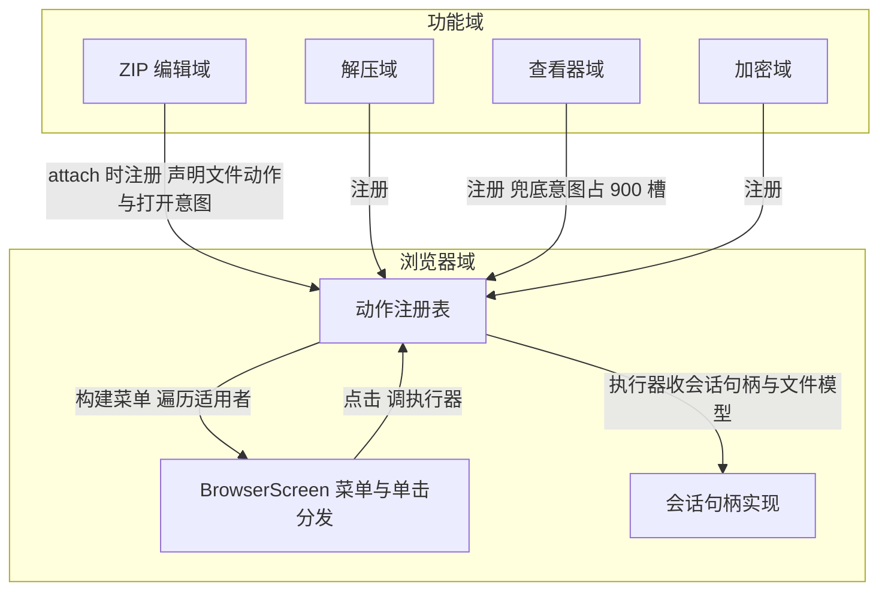

# 文件浏览功能拆解设计

## 1. 设计目的

功能模块化四批完成后，各功能域已经是独立模块（服务进程级存活、调用边在使用点），组合根退为纯粹的启动者。文件浏览域是这套模型的最后一个大件（功能模块化设计留下的 D 档议题），它没有跟着模型化的原因是体量：browser/ 包 6828 行，其中 `BrowserScreen` 单个 Composable 约 2200 行、65 个参数、44 个 remember 状态、16 个对话框分支，`BrowserTabHost` 1442 行。拆它必须先回答"这些代码各自在解决什么问题"，否则只是把大文件切成小文件。

先解剖现状，看这些行数到底是什么。文件浏览的代码分三层堆叠：

* **目录显示**：列表渲染、排序、过滤、滚动位置记忆、目录缓存——这是文件浏览功能自己的本职，有独立设计文档支撑，形态健康。
* **文件操作分发**：单击文件怎么打开、长按菜单有哪些项。这一层的实质是**其他功能域的入口**——打开方式、压缩、加密、ZIP 编辑、转发留言板、导入配置，每一条都是某个功能域在文件浏览页面上开的门。
* **操作会话**：重命名、删除确认、新建、详情面板、搜索——一组只与浏览器自身交互的小对话框。

问题出在第二层的组织方式。每个功能域要在文件浏览页开一扇门，今天要连改三处：`BrowserScreen` 加一个 `onXxx` 回调参数并在菜单的 if 链里加一段适用判断；`BrowserTabHost` 写一行接线 lambda 把参数转发给目标模块的 `service.open(...)`；回调经 65 项参数表穿透。以 ZIP 编辑为例，"这个文件是 zip 吗、菜单项叫什么、点击后做什么"三个判断全部住在浏览器里，而它们的属地是 ZIP 编辑域——这正是主界面判断归位设计属地公理的反例：**浏览器成为所有功能的判断代理**。单击分发把这个症状放大到可见的程度：`openItemByDefault` 是一个 17 分支的 when，每个分支做一次扩展名判断再转发一个回调；`defaultOpenMenuLabel` 是同一张判断表的第二份拷贝（只为给菜单第一项起标题）。判断表写两遍意味着每加一种打开方式要同步改两处，漏一处就是菜单标题与实际行为不符。

2200 行单函数是这些判断边堆积的直接后果：菜单的 19 段 if、分发的 17 分支 when、16 个对话框全部内联在同一个函数作用域里，44 个状态共享同一个生命周期，任何对话框的改动都要在整块代码里定位，也没有任何一段可以单独测试。

因此本设计的目标是：**把"文件能被什么功能操作"的判断归位到各功能域，浏览器退为判断的消费方；把巨函数按职责拆为可独立定位的单元**。这是重构，不改任何用户可见行为。不做的事：不引入框架（沿用模块 object 惰性单例）、不动目录显示层（本职已自洽）、不改各功能域自身（只改它们向浏览器暴露入口的方式）。

设计基线：功能模块化第四批 + ZIP 解压功能完成的工作区（未提交，基于 5157e11）。

## 2. 设计逻辑

### 2.1 能力声明制

拆解的关键不是"怎么把文件切小"，而是"判断边归谁"。回答了这个问题，切分自然发生。

先引入本设计的核心概念——**文件动作**：功能域对浏览器声明的一个自描述单元，包含三件事——对哪个文件适用（适用判断）、用户看到的菜单标题（标题函数）、点击后做什么（执行器，入参是协议数据）。浏览器的职责从"认识每种文件"变为"收集声明、展示、转发调用"：构建菜单时遍历全部声明的文件动作，对目标文件适用的依次出菜单项；用户点击时浏览器调用该项的执行器，执行器内部直接打开自己域的服务。

用一个比喻说明形态变化：现在的浏览器像一家自己雇了所有师傅的大食堂——每个档口的判断、招牌、手艺都写在食堂管理处的手册里（BrowserScreen 的 when 和 if 链）；目标形态是商场——各店铺向物业管理处登记"我卖什么、招牌叫什么、怎么营业"，管理处只负责按登记信息出示楼层导览。

这个方案要成立，有两个必须预先想清楚的机制问题。

**第一个问题：执行器需要浏览器会话的怎么办？** 删除后要刷新列表、加待处理要改待处理列表、转发留言板要切 tab。这些不是纯协议调用。答案是把"浏览器会话能被外部命令做什么"定义成一个受限的命令接口——**会话句柄**（执行器拿到的不是浏览器内部状态对象，而是一个只含 refresh、待处理增删、切 tab 等命令方法的接口）。会话句柄本身是协议数据（功能模块化设计纪律 1 允许回调），浏览器实现它。需要会话的动作（删除、待处理）本来就是浏览器域自己的能力，它们也走同一套声明机制——浏览器域向自己的注册表声明这些动作，与功能域的动作同台展示，用户看到的菜单不再有"浏览器自办"与"外来的"之分。

**第二个问题：单击打开没有菜单项可以逐项展示，怎么选执行者？** 单击语义是"用默认方式打开"，多个声明可能同时适用（.md.zip 同时匹配压缩 Markdown 查看与兜底查看器）。引入第二个概念——**打开意图**：带**优先级槽位**的文件动作子集（槽位是一组固定的整数段：100 压缩包阅读、200 文档、300 媒体、400 归档与加密、500 目录图库、900 浏览器兜底，段间留空隙便于插入）。单击时取全部适用意图中槽位最小者执行；菜单第一项的标题"默认打开（X）"从该意图的标题函数取得。现状 when 分支的书写顺序就是优先级，槽位只是把这条隐式规则显式化。兜底意图（内置查看器）由浏览器域声明在 900 槽——它本来就是浏览器自己的最后手段，留在属地内。

两个概念的声明、收集与执行链路如下：



与现状（调用边经组装点）对比，差别仍在**边的位置**：功能域与浏览器之间只剩"注册"一条边（发生在模块 attach 时，属于启动而非中转），每条功能调用边回到声明它的功能域内部。

### 2.2 注册的时机与归属

注册发生在模块 attach——功能模块化设计已有的模式：每个模块进程级初始化的一行接线。浏览器域提供进程级注册表对象，各模块在自己的 attach 序列里向它注册文件动作与打开意图。组合根不逐条注册（那是中转的复活），只保证启动序列里各模块的 attach 被调用——这本就是它的既有职责。

注册表必须可重置（测试直接构造注册表实例、注册样例动作，不经全局单例），这是四条纪律中"测试走工厂"的直接应用。动作声明本身是无状态的纯描述对象（适用判断与执行器是函数属性），测试菜单构建逻辑时喂入假动作即可断言"哪些适用项、按什么顺序出现"。

### 2.3 巨函数拆解视图

判断边迁出后，`BrowserScreen` 剩下的是目录显示与操作会话，可以按"每段代码为什么存在"切分：

* **浏览器主体**（BrowserScreen.kt 收缩为 Scaffold、列表、菜单与单击分发——分发只剩"取注册表、选槽位、调执行器"三步，约四百行量级）。
* **操作会话对话框**：每个对话框（重命名、新建文件、新建目录、删除确认、打开 URL、外部打开选择）独立成一个文件内的 Composable，状态随对话框内聚。浏览器主体不再持 44 个散状态，改持一个**会话请求**——一个可空的密封类值（`DialogSession.Rename(target)` / `.Delete(target)` / `.Detail(target)` / `.Search` / …），对话框自行 remember 自己的输入框内容，关闭即销毁。这一步消灭"对话框文本残留"与"状态生命周期同域"两类纠缠。
* **详情与元数据**：约六百行的元数据格式化（EXIF、音视频轨、时长/码率）与详情面板迁出为独立文件。它已有独立设计文档（文件详细信息元数据设计），本来就是一个内聚主题。
* **文件搜索对话框**（约两百行）同样独立成文件。

`BrowserTabHost` 随参数表收敛而收缩：四十余个转发型 lambda（`onRequestMdZipView = readingLauncher::mdZip` 这类一行接线）随动作声明制消失，留下的是真正的宿主编排（运行进度、批量操作执行页、待处理解压编排）与会话组装。65 项参数表预期收敛到十五项以内——目录显示所需（config、currentUri、缓存、列表状态）、待处理、导航与少量仍属宿主的编排回调。

`BrowserTabState`（目录会话、后退栈、待处理列表、面板开关）职责清晰，不动。它已经是文件浏览域的服务层核心，拆解完成后再评估是否升格为模块服务，本设计不预支这一步。

### 2.4 分批路线

遵循"先完成一个完整例子，验证可行再推广"的方法论，拆解按四批推进，每批独立编译、测试、真机验证、提交：

| 批次 | 内容 | 验证点 |
| -- | -- | -- |
| 一 | 注册表与会话句柄落地；选一个功能域（压缩包查看，意图数量最多）完整迁入：声明、注册、菜单项、单击分发、删除原回调参数 | 单击 .md.zip 打开压缩阅读，兜底路径不受影响 |
| 二 | 其余打开意图全量迁入（文档、媒体、归档加密、目录图库、兜底），删除 17 分支 when 与标题镜像表 | 全扩展名单击行为与现状逐一对照 |
| 三 | 上下文菜单动作迁入（各功能域动作 + 浏览器域自有动作），参数表收敛 | 菜单项集合、顺序、文案与现状一致 |
| 四 | BrowserScreen 内部拆解：会话请求化、对话框文件化、元数据与搜索迁出 | 行为不变，各文件可在两百行量级内定位 |

第一批里注册表与会话句柄是新的基础设施，必须连同样板一起评审；后续批次是机械推广加核对。

## 3. 功能与数据归属

归属视图要回答的问题是：拆出来的每项能力、每份数据归谁所有——它是编码时的定位约束（“改这个功能去这个对象”）。本设计与以数据为中心的设计不同，几乎不引入持续维护的数据：各功能域在浏览器页面上的行为是“声明后等待调起”，调起所需的信息（目标文件、会话命令）全部由调用当次传入，没有跨调用驻留的功能数据。因此这里的重点是功能归属：

| 归属对象 | 拥有的功能 | 拥有的数据 |
| -- | -- | -- |
| BrowserScreen（浏览器主体） | 菜单收集与展示、单击分发、列表显示（排序/过滤/滚动）、操作会话对话框（重命名/删除/新建/详情/搜索）、兜底打开意图（900 槽） | 会话请求（密封类，同一时刻至多一个活动对话框） |
| BrowserTabState（现状保留） | 目录会话、后退栈、待处理列表、面板开关 | currentUri、backStack、pendingList——持续维护，现状归属已清晰 |
| BrowserActions 注册表 | 收集声明、按需供给 | 声明列表——attach 后不变，是本设计唯一新增的进程级数据 |
| 各功能域（ZIP 编辑、解压、加密、各查看器、留言板…） | 各自的文件动作与打开意图的声明（适用判断+标题+执行） | 无新增——执行器无状态，每次调起当次取参 |

这个表对编码的直接约束，举例说：给 zip 文件加一个新菜单项，全部改动落在 ZIP 编辑域（新增一个声明并在 attach 处注册），浏览器零改动；要改“删除后刷新”的刷新语义，改动落在浏览器域（会话句柄实现），各声明方不动。

两个专门说明。其一，打开意图与文件动作是两类声明而非一类带槽位：菜单消费“全部适用项”，单击消费“槽位最小者”，合并会迫使每个菜单动作声明一个无意义的槽位（无效概念）；两者可以由同一个对象实现，注册表分别收集。其二，现状 BrowserFileTypes.kt 的扩展名判断函数（isCompressedMarkdown 等）是纯函数，随首个声明者迁往所属域，被多域共用的留在 file 包作域间工具——它们是判断的具体实现，位置跟着使用它的声明走，不构成新的归属争议。

## 4. 接口定义（功能启动接口）

接口视图回答的问题是：被分离的这些对象，各自的功能如何被启动。本设计的接口全部围绕“一次功能调起”的链路组织：用户在浏览器页做一个动作，浏览器选中一条声明，声明的执行器启动本域服务。按启动方向分四组。

**声明注册**（功能域调起注册表，attach 时一次性）：

```kotlin
/** 功能域在模块 attach 时调用，声明本域的文件动作与打开意图。 */
fun register(action: BrowserFileAction)
fun register(intent: BrowserOpenIntent)
```

此后浏览器对该域的全部认知都来自这张声明。

**功能调起**（浏览器调起功能域，用户操作时）：

```kotlin
/** 菜单项点击时启动对应功能；ctx = 目标文件 + 会话句柄 + 会话快照。 */
fun BrowserFileAction.run(ctx: BrowserActionContext)
/** 单击分发选中后启动默认打开。 */
fun BrowserOpenIntent.open(target: DocumentFileModel, session: BrowserSessionHandle)
```

执行器内部形态是 `XxxModule.service.open(协议参数)`——与功能模块化设计的模块服务调用同构，浏览器不出现在这条边上。

**会话命令**（功能域调起浏览器，功能执行中或收尾时）：

```kotlin
/** 浏览器对外部动作开放的受限命令接口，浏览器实现。 */
interface BrowserSessionHandle {
    fun refresh()
    fun addToPending(item: DocumentFileModel)
    fun removeFromPending(item: DocumentFileModel)
    fun switchTab(tab: MainTab)
}
```

功能域不读浏览器状态，只发命令；需要判断依据的（如待处理列表是否已含目标）由调用当次的 BrowserActionSnapshot 快照提供。

**对话框会话**（浏览器内部，第四批拆解时落地）：

```kotlin
/** 各操作对话框的启动参数；BrowserScreen 持一个可空值，非空即挂起对应对话框。 */
sealed interface DialogSession {
    data class Rename(val target: DocumentFileModel) : DialogSession
    data class Delete(val target: DocumentFileModel) : DialogSession
    data class Detail(val target: DocumentFileModel) : DialogSession
    // CreateFile / CreateDir / OpenUrl / ExternalOpen / Search …
}
```

每个对话框是一个独立 Composable，自带输入状态，关闭即销毁。

把四组接口串成一次完整调起：功能域 attach 时注册声明；用户长按文件，浏览器遍历声明构建菜单；点击某项，浏览器以该声明的 `run` 启动功能，功能执行中经会话句柄向浏览器发收尾命令（刷新列表、切 tab）；用户单击文件，浏览器按槽位选中一个意图，以其 `open` 启动默认打开——每条功能启动边都终止在实际提供功能的域，浏览器只做选择与转发。

## 5. 一致性校验

* **概念一致性**：全文"文件动作"指菜单操作声明，"打开意图"指单击默认打开声明，"会话句柄"指浏览器受限命令接口，无混用。
* **判断完备性**：现状菜单 19 段 if 与 17 分支 when 的每一项都必须能在迁移清单中找到去处（各批次的验证表逐项对照），兜底意图保证单击永远有执行者。
* **属地回归检查**：迁移后 `BrowserScreen` 中不得残留任何扩展名判断函数调用（isCompressedMarkdown 等留在 BrowserFileTypes.kt，随声明迁往各域或成为域间共享的 file 包工具——判断函数本身是纯函数，位置随首个声明者走，不构成新耦合）。
* **层次一致性**：会话句柄只含命令不含状态读取；需要状态的动作用快照（BrowserActionSnapshot）一次性拷贝，防止注册边退化为共享内部状态。
* **异常情形**：注册表空（某域未 attach）时菜单只剩浏览器域自有项，行为退化为安全子集，不崩溃；两个域声明同 id 时注册表拒绝并日志告警。
* **可测试性**：菜单构建、单击分发、槽位排序均为注册表纯消费逻辑，用假动作测试；对话框拆出后各会话可独立 Compose 测试。

## 6. 实施进度：已迁移功能与接口

每完成一批分离，在此登记已落地的声明与接口，作为代码现状的对应清单。

### 第一批（已完成）：基础设施 + 压缩包阅读意图

**落地文件**：browser/BrowserActions.kt（接口与注册表）、archivereader/ArchiveReaderIntents.kt、epub/EpubReaderIntents.kt；谓词迁往 file/CompressedFileTypes.kt。

**基础设施接口**（BrowserActions.kt，均 internal）：

| 接口 | 成员 | 说明 |
| -- | -- | -- |
| BrowserFileAction | id / labelRes / applies(target, snapshot) / run(ctx) | 菜单动作声明 |
| BrowserOpenIntent | id / slot / labelRes / applies(target) / open(target, session) | 单击打开声明 |
| BrowserSessionHandle | refresh / addToPending / removeFromPending / switchTab | 会话句柄（浏览器实现） |
| BrowserActionSnapshot | pendingUris / zipEditTargetUri / zipEditTargetIsZip / isViewingTrash | 菜单判断依据快照 |
| BrowserActions.Registry | register(action) / register(intent) / matchIntent(target) / menuActions(target, snapshot) | 注册与消费 |

**已注册声明**：

| 声明 id | 域 | 槽位 | 适用 | 执行 |
| -- | -- | -- | -- |
| archivereader.mdzip | 归档查看器 | 100 | .md.zip / .rst.zip | ArchiveReaderModule.service.open(MD_ZIP) |
| archivereader.htmlzip | 归档查看器 | 100 | .html.zip | service.open(HTML_ZIP) |
| archivereader.piczip | 归档查看器 | 100 | .pic.zip | service.open(PIC_ZIP) |
| archivereader.vidzip | 归档查看器 | 100 | .vid.zip | service.open(VID_ZIP) |
| epub.llmzip | EPUB/文本书 | 100 | .llm.zip | EpubReaderModule.service.open(LLM_ZIP) |

**消费点**：BrowserScreen.defaultOpenMenuLabel / openItemByDefault 开头先查 matchIntent（命中即取其 labelRes / open），未命中走遗留 when 分支；后续批次逐个迁移时逐个删除对应分支。

**随批变化**：BrowserScreen 删 5 个回调参数（onRequestMdZipView / onRequestHtmlZipView / onRequestLlmZipView / onRequestPicZipView / onRequestVidZipView）；BrowserTabRouteState 同步删 5 字段、增 session: BrowserSessionHandle；BrowserTabHost 删 5 行转发接线、新增 sessionHandle 实现，deps 出口 requestOpenPlayerTab 泛化为 switchTab(MainTab)；压缩包谓词（5 个）从 browser/BrowserFileTypes.kt 迁往 file/CompressedFileTypes.kt（三方共用）。

**验证**：BrowserActionsTest（5 测试：空表、槽位最小、不适用、重复 id、菜单序）+ 全量 148 绿；真机单击 test.md.zip 打开压缩 Markdown 阅读、长按 test.llm.zip 菜单首项为意图声明文案、单击走点击打开 LLM 阅读页、report.pdf 兜底不受影响，0 FATAL。

## 变更历史

| 日期 | 变更原因和内容 |
| -- | -- |
| 2026-10-20 | 初版：能力声明制拆解方案与四批路线 |
| 2026-10-20 | 评审修订：原"核心数据结构"章实为接口，改为功能与数据归属视图；接口章聚焦被分离对象的功能启动接口 |
| 2026-10-20 | 实施进度节建立；第一批落地：注册表/会话句柄/快照接口 + 5 个压缩包阅读意图迁入，单击分发与菜单首项标题改走意图声明 |
